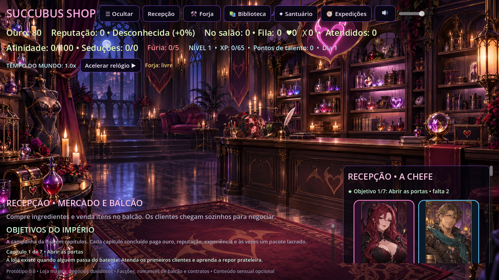
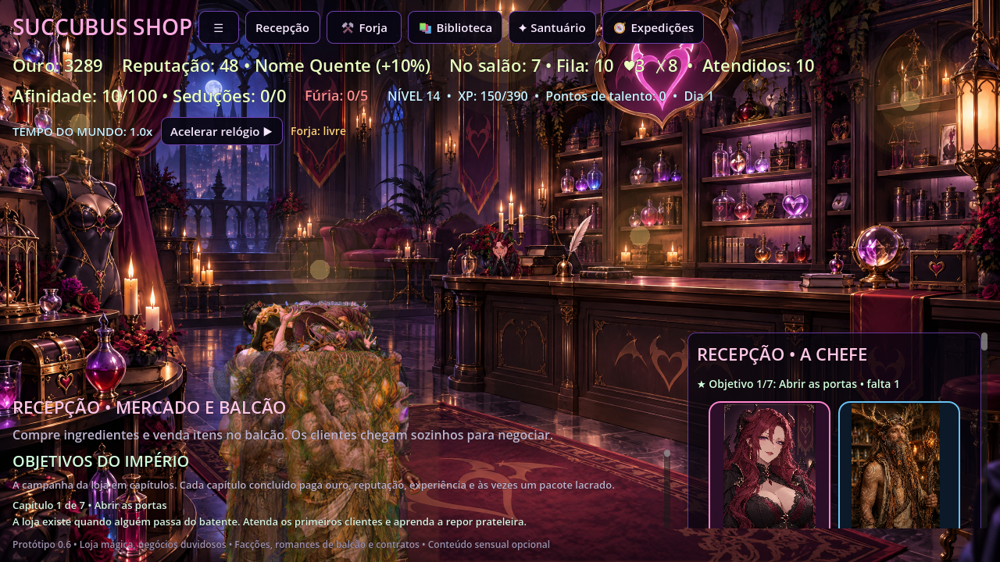
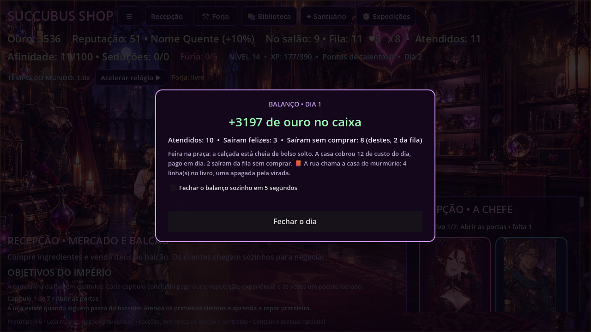
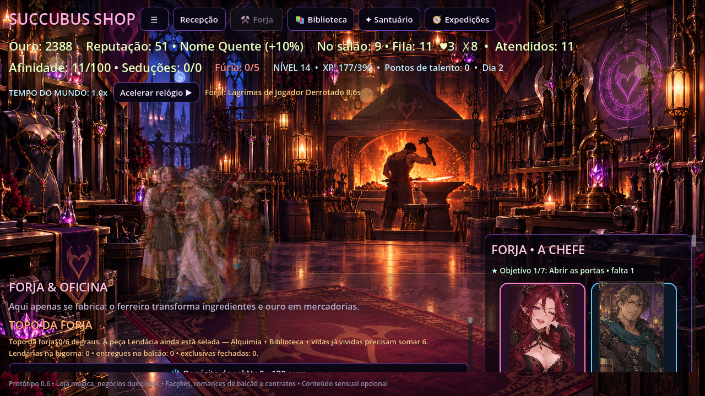
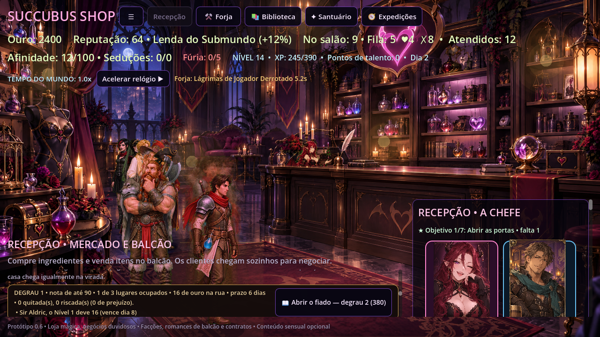
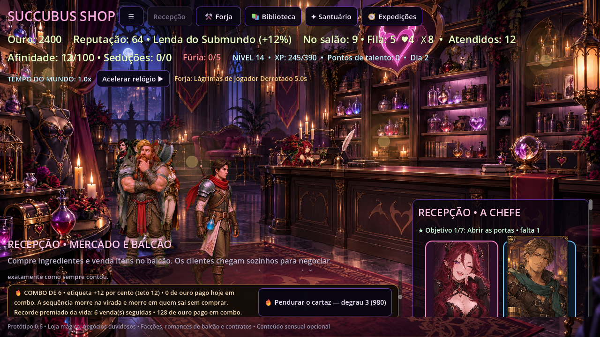
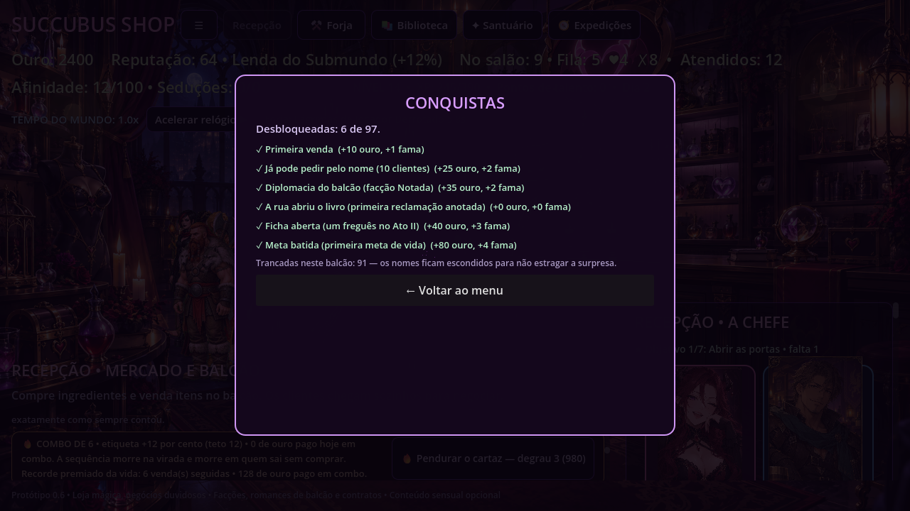
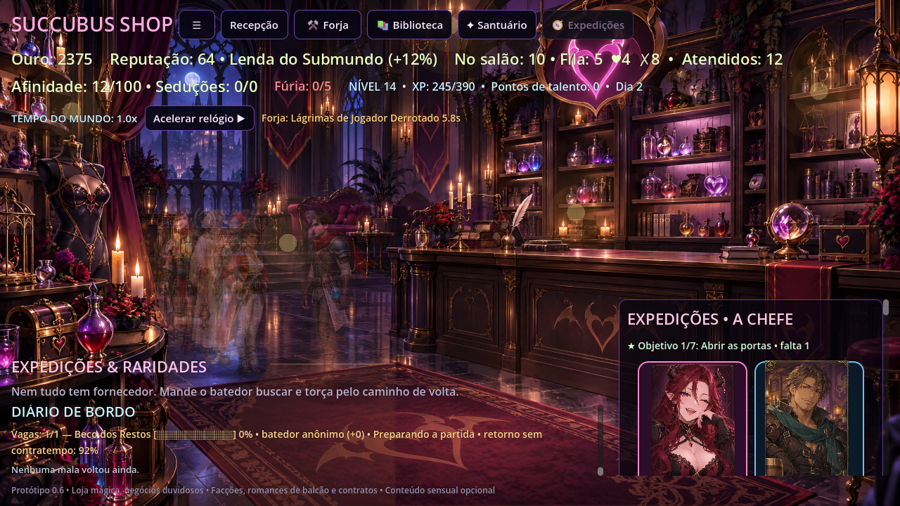

# Succubus Shop

**Uma loja de fantasia, clientes excêntricos e decisões comerciais questionáveis.** Succubus Shop é um jogo de gerenciamento e RPG em desenvolvimento, feito em Godot 4.7.2. A ideia é começar com uma pequena loja e evoluir até um império mágico por meio de planejamento, especialização, exploração e decisões econômicas.

O projeto prioriza conteúdo original, opções de acessibilidade e desenvolvimento com orçamento zero.

## Captura do jogo

Esta captura mostra uma partida limpa no estado atual do protótipo; a interface e o balanceamento ainda estão em evolução.

### Galeria da alpha

As sete telas abaixo são **prints reais da partida**, gerados pela sonda `tools/probes/galeria.gd` (o comando está no cabeçalho dela) numa loja já em andamento: mesmo HUD, mesmos cartões e mesmos números que aparecem jogando. Regenerar a galeria é rodar a sonda e copiar os PNGs para `screenshots/`.

| O salão com a fila no balcão | A conta do dia | A forja com peça na brasa |
|---|---|---|
|  |  |  |
| O balcão atende quem chega sozinho: fila, paciência e o caixa mudando a cada tique. | A virada fecha a conta do dia — não a vida inteira — e diz o que a rua cobrou. | O cronômetro da bigorna corre no alto da tela: a peça sai do tempo de mundo, não do clique. |

| O livro de fiado | O cartaz do combo |
|---|---|
|  |  |
| Quem não paga leva a peça anotada: nome, valor e dia de vencimento no livro. | A sequência do mesmo dia paga ouro na etiqueta e morre na virada. |

| O painel de conquistas | A estrada com expedição em curso |
|---|---|
|  |  |
| Cada selo paga ouro e fama na hora e mostra o que ainda falta. | O batedor some no mapa e volta com o saco — ou com o contratempo. |

### Visão conceitual da meta final

Isto é uma ilustração de visão — não uma captura de funcionalidades já jogáveis. O objetivo é ligar gestão da loja, equipes de aventura, defesa e prestígio numa progressão longa.

## Estado do projeto

**Alpha jogável em desenvolvimento.** Já há fabricação e venda de produtos, cadeia de produção com ingredientes e qualidade, **estoque que vence na prateleira e depósito de sal que compra prazo**, economia reativa, clientes automáticos, expedições, santuário de relíquias, cartas colecionáveis que evoluem e pagam bônus de balcão, campanha em sete capítulos com sete desfechos (seis por facção mais a ruína), **os três pedidos escritos de cada uma das cinco facções, que pagam privilégio permanente e atravessam a reencarnação**, custo diário da casa e dívida com teto, filiais fora do salão que pagam por virada e engrossam a conta, **quatro vagas de funcionários com taxa, salário na conta diária e entrega dentro das fórmulas que a loja já tinha**, reencarnação do império com aura, dotes permanentes e placar por temporada, **a loja em três idiomas (português, inglês e espanhol) com escolha na primeira abertura e menu no ESC**, conquistas, placar de pontuação, integração opcional com a Steam e progressão por nível, pontos de talento **com dois ofícios concorrentes por trilha — assinar um raspa o outro até a próxima vida**, contratos de loja e reputação por facção. A versão alpha é jogável, mas interface, balanceamento e conteúdo ainda precisam de testes.

## Baixar e jogar a alpha

- **Windows 10/11 (64 bits):** [baixar Succubus Shop v0.1.0-alpha.5](https://github.com/GMGuimaraes/succubus-shop/releases/tag/v0.1.0-alpha.5), extrair o ZIP e executar `Succubus Shop.exe`. O build é portátil e não exige Godot instalado.
- **Steam:** o executável Windows também pode ser adicionado à biblioteca pelo menu **Adicionar um jogo → Adicionar um jogo não Steam**. O pacote tem formato compatível com um depot Windows; a publicação como aplicativo próprio na loja Steam ainda depende do AppID, configuração de depots e credenciais do parceiro Steam.
- Para jogar pelo projeto-fonte, instale Godot 4.7.2, abra `project.godot` e execute a cena principal com **F6/F5**.

Esta é uma versão alpha: faça cópias de segurança dos saves e espere mudanças de balanceamento. O jogo exportado não leva o editor Godot.

## Relatórios de problemas e privacidade

O jogo mantém um log local em `user://logs/godot.log` para ajudar a investigar erros. O log **não é transmitido em segundo plano**. Use **🐞 Relatar um problema** no menu (a mesma porta do **ESC** e do botão **☰** no canto do painel) para preparar um issue com versão, sistema operacional, FPS, memória estática estimada e somente os 1.500 caracteres mais recentes do log; nome é opcional. É necessário marcar o consentimento, revisar o texto no GitHub e publicar manualmente. Issues e logs publicados ficam visíveis publicamente: remova informações pessoais antes de enviar.

## DLCs e anúncios futuros

A camada `commerce.gd` separa catálogo/entitlements da lógica do jogo e a integração Steam oferece pontos de verificação de DLC e acesso à página da loja. Os AppIDs e produtos ainda não foram fornecidos, portanto nenhum DLC pago está ativo. Anúncios também estão **desativados** e não há SDK de anúncios no alpha; o contrato só permitirá posicionamentos explicitamente solicitados e fora do fluxo normal da partida. Não há banners, intersticiais nem anúncios automáticos.

## Como jogar pelo projeto-fonte

1. Instale o Godot 4.7.2.
2. Baixe ou clone este repositório.
3. Importe a pasta do projeto no Godot e abra `project.godot`.
4. Execute a cena principal com **F6/F5** ou o botão de executar projeto.

## Requisitos mínimos estimados

- **Sistema:** Windows 10 ou posterior, 64 bits. O projeto ainda não foi validado em outras plataformas.
- **Gráficos:** GPU compatível com OpenGL 3.3; o projeto usa o renderizador GL Compatibility e janela de referência 1280 × 720.
- **Processador e memória:** estimativa inicial de CPU dual-core e 4 GB de RAM; ainda sem benchmark em hardware de entrada.
- **Espaço em disco:** **170 MB** para o pacote da alpha (`Succubus-Shop-Windows-Alpha.zip` medido em 169.679.606 bytes na publicação `v0.1.0-alpha.5`), mais alguns KB por save. O número é do arquivo publicado, não uma estimativa.
- **Desenvolvimento:** Godot 4.7.2 para abrir e executar o projeto pelo editor. Builds alpha Windows 64-bit são publicados em Releases.

## Recursos atuais

- **Doze produtos no catálogo atual**, com receitas presas ao nível que a biblioteca adianta por ouro.
- **Clientes com personalidade**, falas próprias e preferências por produtos.
- **Economia de loja** com ouro, reputação, estoque, custos de fabricação, propaganda e **fabricação e expedição em tempo de mundo**: você inicia, o relógio termina. Não há produção que rode sem um clique seu — automação de verdade continua na lista de etapas futuras.
- **Eventos raros** com consequências positivas ou negativas.
- **Progressão de RPG**: vendas, fabricação e eventos rendem experiência; subir de nível concede ouro, reputação e pontos de talento.
- **Cinco trilhas de talentos**, cada uma com até cinco níveis: Alquimia reduz custos e melhora a qualidade, Comércio aumenta receita e barateia receitas, Carisma acelera a afinidade e salva visitas, Logística encurta expedições e abre a segunda vaga de batedor, e **Administração da Casa** emagrece a conta diária da loja 8% por nível (numa casa grande, 230 de ouro por virada caem para 138), corta 1% do dia ruim de cada filial a partir do nível 2 e, no nível máximo, sobe o teto da dívida de 240 para 300. Vinte e cinco degraus para um ponto por nível: a quinta trilha é o que faz o ponto de talento valer escolha. Talento é da vida — reencerrar ou reabrir depois da ruína zera os cinco ramos.
- **Especializações concorrentes** (`talent_specs.gd`): cada trilha tem **dois ofícios** e a casa assina **um** — dez ofícios no total, dois por ramo, e a escolha abre no quarto degrau da trilha. Assinar é grátis e definitiva: o quinto ponto de talento daquela trilha **não é gasto sem assinatura na parede**, o ofício escolhido entra na fórmula que a trilha já mexe, e o rival fica **raspado até a próxima vida** — raspar a tinta não dá, só reencarnar, e a reencarnação zera as cinco assinaturas junto dos degraus. Os números abaixo são do probe, medidos antes e depois de cada assinatura:
  - **Alquimia** — *Destilaria fina* dá +1 de sorte na forja (a chance Lendária sobe com ela); *Linha de montagem* derruba 12% do custo de fabricar (fator 1,000 → 0,880 e a peça de 8 sai por 7; empilha com a trilha no 3: 0,850 → 0,748 e a mesma peça sai por 6).
  - **Comércio** — *Cartel de etiqueta* sobe 8% toda etiqueta (16 vendas: +1514 → +1551 de caixa); *Varejo humilde* deixa a etiqueta como está (16 vendas: os mesmos +1514 do controle) mas empurra o burburinho pela metade (a soma do empurrão do dia cai de 3,52 para 1,76 — estoque encalhado derruba menos preço, porque a loja grita menos sobre o que vendeu barato).
  - **Carisma** — *Coração cheio* dá +1 de afeição por venda (16 vendas: afeição +16 → +32 com o caixa exatamente igual); *Boca de ouro* soma 15 pontos percentuais na chance de salvar a visita sem estoque (prateleira vazia com Carisma 0: 18 reclamações e -16 de fama → 15 reclamações e -15).
  - **Logística** — *Estrada curta* encurta 15% toda expedição com piso de dez segundos de mundo (45 → 38,3, 90 → 76,5, 150 → 127,5, 240 → 204, e uma viagem curta continua cobrando o piso); *Compra em volume* barateia a matéria-prima em 10% (cesta dos seis ingredientes 35 → 32, e 28 com a trilha no 3; item a item: essência 5 → 4, pena 6 → 5, sal 4 → 3, fragmento vazio 3 → 2, pó lunar 10 → 8, tinta 7 → 6).
  - **Administração da Casa** — *Livro-caixa* corta mais 10% da conta diária, por cima dos 8% por nível da trilha (53 → 48; com a Casa no degrau 3, 40 → 36); *Porteiro atento* soma +2 de zelo, o número que derruba o dia ruim de cada filial (feira 15,0% → 13,0%; com o beco, zelo 3 → 5 e 12,0% → 10,0%, e o lucro esperado por virada sobe de +17,0 para +17,4 porque a filial cobra menos conserto). A recepção escreve a origem de cada ponto cortado: "-9% de dia ruim (4 da casa + 2 do porteiro + 3 do beco)".

  Save antigo não tem a chave `spec_choice` e acorda sem assinatura nenhuma, com as cinco trilhas abertas para assinar do quarto degrau em diante. Duas conquistas novas: *Cinco ofícios na parede* (as cinco assinadas na mesma vida) e *A destilaria pagou a peça* (Destilaria fina assinada e uma peça Lendária vendida no balcão).
- **Contratos rotativos** para atender clientes, faturar, fabricar ou encontrar eventos raros. As recompensas aumentam conforme os dias de loja avançam.
- **Diabrete estagiário** que produz poções sozinho, mas gasta matéria-prima da despensa: sem ingrediente ele não inventa nada, para a contratação não transformar a forja e o mercado em enfeite.
- **Reações dos clientes**: cada visita termina com o cliente *encantado* (comprou o item favorito: +1 de reputação), *satisfeito* ou *decepcionado* (loja sem estoque: -1 de reputação). O retrato do cliente reage com animação, a chefe responde com falas próprias e o talento Carisma dá chance de salvar a visita no charme. Quando a prateleira está vazia, quem reclama é um dos fregueses conhecidos: cada um dos nove tem uma queixa escrita para esse momento, e ela aparece no registro da loja.
- **Fregueses recorrentes**: nove personagens nomeados podem voltar à loja; o progresso de amizade é salvo, há quatro níveis de vínculo, diálogos que mudam conforme a relação e falas especiais ao subir de nível. O painel lateral acompanha visitas, nível de vínculo e pedidos concluídos.
- **Pedidos pessoais**: fregueses conhecidos podem pedir seu produto favorito. Atender ao pedido rende bônus de ouro, experiência extra e mais amizade; o total de pedidos especiais concluídos por personagem fica salvo.
- **Missões de história dos fregueses**: ao alcançar 3 pontos de amizade, cada personagem inicia uma missão acompanhada por compras do item favorito. Três compras favoritas concluem o capítulo, concedem ouro escalável com o nível, +30 XP e +2 de reputação; progresso e capítulos concluídos são salvos.
- **Escada de confiança por freguês**: quem sai bem atendido volta a fim de um convite, e o convite sobe três degraus — Convite (5 visitas, 40 ouro), Encontro (9 visitas, 120 ouro) e Momento a dois (15 visitas, 280 ouro). Cada degrau deixa a conta daquele freguês mais cara para sempre (+8%, +16%, +25%), vale vínculo extra por visita, e o degrau final paga gorjeta a cada compra dele. A cena passa no próprio salão: a chefe contorna o balcão, o par fica lado a lado, e a pose de emoção segura o gesto até o fim em vez de perder o quadro no meio do passo. O último degrau corta antes de mostrar qualquer coisa e continua disponível mesmo com o conteúdo sensual desligado — o que muda é o tom, não a progressão. Cada freguês tem três falas próprias de romance em `regulars.gd`.
- **A loja muda de cara com o placar**: o salão cresce em **arte**, não em tinta sobre a mesma arte. Cinco PNGs do MESMO cômodo, filmados da MESMA câmera, cada um num estado diferente da obra, e a escada lê o mesmo `business_score` que o painel já mostra: **casa em obras (0), balcão arrumado (900), casa respeitada (2.400), endereço no bairro (5.200), império da rua (9.000)**. A faixa 2 é a arte que a loja sempre teve (`shop_scene.png`) — ela só deixou de ser o ponto de partida de todo mundo: **o jogo abre na faixa 0**, porque abrir pronta é a escada inteira perder o degrau zero — e quem volta numa casa já crescida acorda nela, porque `_load_game()` roda antes de `_build_ui()` e a primeira tela é a arte do placar salvo (medido: save da faixa 4 abre no império). Sobre a arte entra só a luz da sala, faixa a faixa: fundo `x0,80 / x0,82 / x0,95` no casarão cru, **a cor pintada no meio da escada** (faixa 2) e `x1,10 / x1,06 / x0,94` no império; o elenco acompanha a sala a 0,78 do degradê (corpo aceso demais num salão escuro é desenho colado por cima da foto) e o alfa continua sendo do fade de troca de sala. A poeira engorda de **52 partículas de gesso no canteiro para 72 de ouro no topo**, passando pelo fundo de **36** na faixa 1. Medido na sonda `tools/probes/cara.gd`, foto contra foto com elenco, painel, poeira e luz congelados: a escada abre **26,44 → 27,95 → 34,23 → 39,16** de diferença média por canal de uma faixa para a seguinte (escala 0–255 da tela inteira) e **0,00** da primeira tela para a faixa 0 — as duas já são o mesmo casarão cru, e é esse 0,00 que prova a abertura. Subir de faixa dá aviso no balcão ("A casa virou endereço no bairro: + dourado nas molduras, lustre no teto e o sofá da frente") e a chefe comemora no palco; descer não comemora e carregar uma casa já crescida também não. A régua é o placar, então nada aqui é meta nova: é consequência visível do que já era.
- **A reforma é o que o placar paga, e cada degrau tem casa nova** (#70): a faixa 0 não é um salão pronto mais escuro, é **outro desenho** — parede sem tinta, prancha sobre cavaletes no lugar do balcão, uma lâmpada no fio. A faixa 1 entalha o balcão, estende o primeiro tapete e pendura as duas prateleiras de frascos; a 3 bota ouro nas molduras, acende o lustre e põe o sofá na frente; a 4 acende o teto inteiro, faz a relíquia transbordar e leva o tapete bordado até a porta. Os cinco estados são **um só jogo de coordenadas**: `_apply_room_props` normaliza qualquer arte da escada pela chave do salão cheio, então porta, fila, vitrine e ponto de encontro não mudam com a faixa — e a sonda confere que a geometria lida é `shop_scene.png` enquanto a arte pintada é a da faixa. **O chão é a segunda exceção, e ele nasceu de bug relatado**: cada arte pinta o próprio fundo numa altura diferente, e com a faixa única do salão (0,60) o elenco do fundo ficava plantado **na parede** em quatro das cinco faixas — "os personagens parecem flutuar porque o chão acaba antes". Lido a olho na régua de `tools/probes/chao.gd` (um fio a cada 0,01 de tela, porque detector automático de junção leu 0,673 no salão cheio onde a junção real é 0,575), o assoalho nasce em **0,672 / 0,685 / 0,575 / 0,615 / 0,655** nas faixas 0 a 4; a faixa da arte vale antes da da sala (`STAGE_ART_FLOOR`), e o pé mais fundo (profundidade 0,08) pisa hoje **7, 7, 30, 11 e 8 pixels** dentro do mármore pintado. Biblioteca (0,655→0,665) e santuário (0,585→0,600) receberam a mesma correção na faixa **da sala**: estavam a **3 e 1 pixel** da junção — tecnicamente no chão, visivelmente flutuando, porque sombra e pé não têm piso abaixo. A sonda fecha com **0 de 144 linhas de pé acima do piso pintado** nas vinte e quatro cenas fotografadas (cinco faixas do salão + quatro salas + as **quinze artes da escada de ofício**), e a auditoria de oclusão continua **0 de 165 pontos, pior excesso +0,0%**: mexer no chão move a chefe junto (ela desce a 0,731 de tela na faixa 1, 80,2% do corpo atrás do balcão) e o recorte dela é lido da mesma arte, então as duas tabelas têm de ser medidas na mesma rodada. Nas artes de ofício o pé mais fundo (profundidade 0,08) pisa entre **+10 e +21 pixels** dentro do assoalho pintado, com uma exceção lida e tolerada: a biblioteca arrumada tem o piso pintado **50 pixels** acima do pé herdado da sala, então quem anda no fundo dela pisa fundo demais — não flutua, e por isso a entrada própria ficou para a rodada do recorte. **O recorte de móveis é a exceção, e de propósito**: cada faixa pinta o próprio balcão numa altura diferente, então o contorno vem da **arte** (`STAGE_ART_PROPS`), não da sala. Enquanto as quatro faixas novas herdaram o polígono do salão cheio, a chefe era engolida até **0,035 de tela antes** do móvel realmente pintado na faixa (casa em obras corta em 0,525 e o herdado era 0,49) — o corpo sumia no chão vazio à frente do balcão, não atrás da madeira. Medido em `tools/probes/recorte.gd`: o corte na coluna da chefe fica em **0,524 / 0,514 / 0,490 / 0,496 / 0,521** nas cinco faixas, e a sonda reprova qualquer faixa da escada sem recorte próprio. A auditoria de oclusão (`tools/probes/caminhos.gd`) fecha com **0 de 165 pontos fora da tolerância, pior excesso +0,0%** — e fixa a janela em 1280×720, porque em headless o viewport nasce 1280×1280, o corpo tem altura fixa em pixels e toda fração de oclusão sai errada. Instalação sem um dos arquivos (fatia de arte não importada, teste em máquina limpa) degrada **para a arte cheia**, não para o fundo preto. Sala que não é o salão não recebe a escada **da casa**: close-up de cena e guilda continuam intocados quando a faixa vira, e a recepção reaberta reencontra a arte do placar — forja, biblioteca e santuário têm escada própria, medida no trabalho do próprio banco (veja *Cada ofício tem trinta cenários*). Medido em `tools/probes/cara.gd`: **0,00** na sala sem chão, faixa 4 lida duas vezes batendo **0,00 / 0,00** (a arte não depende de sorteio nem treme de um redraw para o outro), placar 999.999.999 ainda na banda 4, e a reencarnação devolvendo o império ao casarão cru.
- **Cada ofício tem trinta cenários** (#86): forja, biblioteca e santuário ganharam a mesma escada de arte da recepção, medida no trabalho do próprio banco e não no placar da loja — **forjar** (`total_crafted` + nível de alquimia ×4 + peça Lendária ×6), **estudar** (nível da biblioteca ×6 + consultas) e **acalmar relíquia** (nível do santuário ×6 + rituais + relíquias calmas). São **30 degraus por sala**, lidos como **6 artes × 5 andares de luz e poeira**: a banda de arte vira aos 14/44/92/170/280 de ofício na forja e aos 10/28/52/84/124 na biblioteca e no santuário, e dentro de cada banda a luz ainda sobe cinco vezes. Medido na sonda `tools/probes/cenario.gd`, varrendo o placar até o teto: **30/30 degraus atingidos nas três salas**, bandas lidas **[0, 1, 2, 3, 4, 5]**, e placar 1e9 parado em **degrau 29, banda 5** — a escada tem degrau, não estoura. **O degrau zero é a sala crua e não move número nenhum**: avaliar 49 estados da escada consome **cauda de 40 `randi()` idêntica ao controle** que nunca chamou a função, e pintar a sala deixa **ouro 80 → 80, fama 0 → 0**. A corrida de 200 tiques com a mesma semente nos dois lados bate **caixa 4388 • fama 0 • atendidos 5 • perdidos 0 • dia 0 • placar 4609** cru e no topo — cenário é consequência do ofício, nunca meta nova que engorda a conta. O painel da sala lê a escada ("A SALA ESTÁ: casa do ofício — degrau 16/30", com a próxima arte em N de ofício), e o texto passa por EN e ES na mesma entrada: **29 chaves nos dois idiomas**, provadas pela sonda de idioma vizinha. Save antigo não tem as chaves `library_consults` nem `relics_calmed` e acorda **no degrau 0 da sala**, com a arte cheia no lugar da fatia faltante — **6 de 6 artes pintadas por sala, nenhuma degradando mais** — e payload adulterado (negativo e string) volta a zero na carga, enquanto **consultas 37 e relíquias 21** atravessam o disco. Escada de ofício é **da vida**: reencarnar com 25/20/20 devolve as três salas a **0/0/0**. Três conquistas novas, uma por sala no degrau 30 — *A forja tem telhado de brasa*, *Estante até o forro* e *Colunata acesa* — e a parede fecha com **100 definições**. **Arte nova não entra no arquivo sem chão medido**: a faixa de piso é por arte (`STAGE_ART_FLOOR`, lida a olho na régua de `tools/probes/chao.gd`), e as quinze artes da escada agora têm entrada própria ou herdada **conferida cena por cena**. O recorte de móvel, esse continua **por sala** nas três oficinas — e é decisão medida, não esquecimento: a cartela nova de `tools/probes/recorte.gd` risca o contorno herdado por cima de cada uma das dezoito artes de ofício, o móvel pintado daquelas salas corre na parede (estante, banco de velas, altar lateral) na mesma faixa de x banda após banda, e **nenhuma delas cobre o x do ponto de encontro** (0,30 na forja, 0,42 na biblioteca, 0,50 no santuário) — ou seja, a chefe nunca é cortada no ar. Recorte próprio por arte é o que a recepção e o salão de expedições têm porque lá o balcão muda de altura a cada faixa.
- **A guilda tem casa própria** (#82): a aba de expedições deixou de ser o próprio salão da recepção emprestado. É **sala de guerra**: mesa de cartas de estrada no meio do salão, com lampião, mapas e um dado de ossos, estandartes na parede, globo, baú de corda, tocheiros acesos e um **arco aberto para a rua lua afora** pelo único ponto por onde o batedor sai. A sala tem chão, porta, fila, vitrine, ponto de encontro e luzes próprios nas nove tabelas de palco, e a mesa de guerra é o balcão da guilda: entra como **contorno inclinado a 0,50 de profundidade**, com a chefe trabalhando ATRÁS dela (cabeça e ombro acima do tampo, do mesmo jeito que atrás do balcão da loja) e as duas pilhas de caixote encostadas na parede do fundo a 0,05 e 0,09 — porque sem profundidade própria o tampo engoliria a fila inteira, que espera JUSTO na frente dele. **O fio de cima do contorno é a quina longínqua do tampo pintado (y≈0,45), não a superfície onde o mapa está desenhado (0,51)**: cortar na superfície deixava a chefe com as pernas atravessadas sobre o mapa, e a sonda `tools/probes/recorte.gd` mede hoje **87% do corpo dela escondido** pela mesa — é a sala onde o móvel pintado é alto na altura do peito de quem atende. A visita entra pelo arco da direita, atravessa o piso livre e para diante da mesa; a trilha de passeio fica de fora de propósito, então quem circula passa **por trás** da mesa e some na altura certa. Medido na auditoria de oclusão (`tools/probes/caminhos.gd`) e na sonda `tools/probes/cara.gd`: os 15 pontos de chão novos da guilda (seis de fila, duas vitrines, três chegadas, o pé da mesa e os dois degraus da porta) dão **0% de corpo engolido**, e a guilda não recebe a escada de arte da recepção — ofício alugado tem uma casa só.
- **A casa suja cobra, e a cela paga o próprio prato**: barro no chão é conta, não cenário. Cada visita que sai pela porta deixa 2 de sujeira e cada desistente da fila mais 3, e o salão medido em `tools/probes/casa.gd` mostra o preço em duas fórmulas que já existiam: **fila perde 1 tique a cada 34 de barro** (6 → 5 → 4, com teto de −2, nunca menos de um tique) e **etiqueta cai até −15%** (x0,951 com 33, x0,850 no teto). Três mãos tiram o pé do chão: o **balde da chefe custa 18 ouro** e zera o salão na hora — sobe com filial e reforma (36 com uma filial e quatro reformas) mas **não sobe com a marcha de Administração**, para investir na trilha não engrossar a própria conta; a **criada Anica Cerdha** na folha varre 20 por virada por 20 de salário; cada **servo apaixonado varre 4 por afeto**. Sujeira também chama visita indesejada: a chance de **vândalo na virada é de 0% com o salão limpo e 30 de fama, 14% com o salão cheio, 22% com o salão cheio e fama zero**, e o ladrão pego em flagrente agora tem destino: **a cela do santuário**, uma porta trancada por reforma (Nv.2 guarda dois). Preso rende **1 frasco de sangue morno por virada** — raridade de forja com sorte 3, exatamente como lágrima e brasa — e custa **3 de conta por cabeça** (dois presos: +6 na conta de 56). O destino dele é escolha escrita no painel, e as três portas foram medidas: **soltar** devolve +1 de fama e +1 de vínculo a um freguês de casa; **entregar à guilda** paga 15 mais o nível da chefe em ouro e +2 de fama e deixa o estoque de sangue intacto; **expulsar do bairro** fecha a porta para sempre — o banido **não aparece em 2.000 sorteios de visita** — e derruba o servo que ele era. Servo preso não atende balcão: a vaga volta enquanto ele responde. Vida nova limpa tudo (chão, cela e banimento), e o round-trip do save confere salão, presos, banidos e colheita atravessando o carregamento.
- **Servos da casa (o balcão que o afeto paga)**: um freguês apaixonado pode pedir para ficar trabalhando no balcão, **sem salário** — e a vaga não é comprada com ouro, é degrau de sedução provada: a casa abre **1 vaga a cada 4, 10, 18 e 30 seduções** bem-sucedidas, teto de quatro. Cada servo segura três pontas da loja, medidas na sonda `tools/probes/servos.gd` numa casa com folha cheia (conta de 160 por virada, fila de 10 tiques): **+1 tique de paciência na fila** por corpo (4 servos = fila de 10 para 14), **-8 de conta da casa por virada** (8 → 16 → 24 → 32) e **+2% na etiqueta** empilhado (x1,020 → x1,080), mais **6% de barrar furto** cada um (quatro servos seguram 24% das tentativas, somados à ronda). O afeto cobra temperamento: uma visita que sai decepcionada com a chefe já em 3 de fúria manda **um servo embora** — "eu trabalho aqui, mas ninguém me deve gritar" — e a vaga volta a ficar livre para o próximo. Com o **conteúdo sensual desligado** a cena muda de tom (ele deve a vaga à fidelidade, não ao feitiço), mas a porta é a mesma e ninguém tem progressão cortada pelo filtro, medido na mesma sonda. Servo é vínculo, não CNPJ: **reencarnar não devolve os servos**, só o reset total desfaz a escolha deles. Duas conquistas novas: *Coração atrás do balcão* e *A casa tem coração*.
- **Diálogo que responde à campanha**: a negociação não fala solta. Cada capítulo da campanha tem as suas falas — no primeiro dia a rua ainda desconfia do balcão novo, no meio da história a freguesia cobra cupom e fila, e depois que o império fecha ninguém mais pede desconto. São falas para o freguês e para a chefe em cada um dos sete capítulos mais o depois-da-história, sorteadas por cima da fala padrão, que continua valendo quando a paciência está no fim.
- **Encomendas de longo prazo**: além do contrato do dia, que nasce e morre na virada, um patrono deixa sobre o balcão um pedido em três etapas que atravessa dias — fabricar, atender, faturar e presenciar raridades na mesma ordem, com prazo contado. Cada etapa paga ouro e XP na entrega; fechar a encomenda inteira paga bônus, reputação e prestígio extra para a facção do patrono, e atrasar custa 4 de reputação. São cinco encomendas, uma por facção, e o balcão recebe a seguinte dois dias depois de entregá-la inteira — quem deixa o prazo vencer recebe a próxima já no dia seguinte, com a reputação cobrada na hora.
- **Três encomendas exclusivas do topo da forja**: Guildas, Coroa e o submundo sem rosto só encomendam quando a casa já tem bigorna para cumprir — com a forja abaixo da porta de seis degraus, elas nem entram no sorteio de oferta. Cada uma pede peça Lendária entregue no balcão (uma, uma e duas), no meio de etapas de fabricar, faturar e presenciar raridades, e paga bem mais que a encomenda comum da mesma facção: ouro de etapa de até 480, bônus final de até 820, reputação e prestígio de facção acima de qualquer contrato do dia. A barra da recepção marca o pedido como "EXCLUSIVA DO TOPO DA FORJA", e a etapa Lendária só avança quando a peça sai pela porta vendida — roubada não conta, porque o patrono quer a nota fiscal.
- **Reputação por facção**: guildas, nobres, aventureiros, mercadores e o submundo lembram negócios concluídos. Cada venda aumenta o prestígio da facção do cliente; quatro níveis (Desconhecida, Notada, Respeitada, Lenda) dão bônus de preço de 0% a 20%, ouro ao subir de patamar e duas conquistas novas. Saves antigos começam com todas as facções em zero.
- **Pedidos das facções** (`faction_arcs.gd`): cada uma das cinco facções tem **três pedidos escritos** — quinze no caderno inteiro — e eles não criam tarefa nova: cobram caminho que a loja já percorre por outro motivo. Haskar das Guildas quer seis peças na bigorna, três delas Refinada ou melhor e uma encomenda de longo prazo cumprida no prazo; a dama Ophélia Vane quer cinco clientes do tipo dela bem atendidos, 25 de reputação no bairro e a Vitrine da Corte acesa; Ruka Meio-Escudo quer duas expedições de volta, três raridades no balcão e quatro eventos raros para contar na taberna; Sabet Corvo quer seis clientes de banca, 1200 de ouro no caixa na hora em que ele bate na porta e trinta compras feitas na banca dele; a Senhora das Contas quer quatro clientes sem nome, uma dívida de 120 quitada em dia e dois níveis de Administração da Casa. Cada pedido cobra também **fama de facção** (5, 15 e 30 — exatamente Notada, Respeitada e Lenda) e o **capítulo da campanha** já fechado (1 a 6), e o botão da recepção escreve falta quanto antes de liberar a entrega. O pagamento é ouro (120 a 640), reputação, experiência e fama daquela facção, o que empurra o degrau seguinte. Fechar os três entrega um **privilégio permanente**, e cada um entra numa fórmula que já existia, medida no probe: **Selo de bancada** derruba 10% o custo de fabricar (empilha com Alquimia: fator 0,850 vira 0,765, e a peça de 8 sai por 6); **Carta de recomendação** sobe 6% toda etiqueta; **Pacto de estrada** dá +1 de sorte na forja, na estrada e no sorteio do pacote; **Fornecedor fiel** barateia a matéria-prima em 12% (a cesta dos seis ingredientes sai de 35 para 31, com o arredondamento de cada preço no meio); **Porta sem placa** corta 3 pontos percentuais do dia ruim de cada filial (o Anexo do Beco cai de 45% para 42% só com o beco, e o lucro esperado sobe de +141 para +154 com a Casa no nível 3). O caderno é da família, não da vida: **reencarnar e a ruína não apagam pedido entregue nenhum**, e o privilégio continua valendo na vida seguinte — o que zera é a contagem de clientes por facção, que é do balcão daquela temporada. Fechar um arco também solta um pacote de cartas para a coleção acompanhar a história. Duas conquistas novas: *Primeira assinatura no caderno* e *As cinco fachadas assinadas*. Save antigo não tem as duas chaves e acorda com o caderno vazio, sem nada atrasado para pagar.
- **Polimento visual da loja**: cartões de mercadorias com bordas violeta mais legíveis, cantos arredondados e sombra sutil para separar melhor os itens do fundo gótico.
- **Afinidade com a protagonista**, diálogos sugestivos e momentos especiais desbloqueáveis.
- **Fúria com preço no balcão**: cada ponto de fúria derruba 5% do valor da etiqueta (até -25%) e, a partir de dois pontos, também corrói a paciência do cliente. O painel mostra a penalidade, e dissipar a fúria no santuário volta a valer alguma coisa.
- **Afeição que transborda em reputação**: com o coração da chefe cheio (100), o excedente de afinidade não é jogado fora — cada 5 pontos de sobra vira +1 de reputação. Momentos privados contam para a pontuação do império e rendem a conquista correspondente.
- **Cadeia de produção com qualidade**: seis ingredientes básicos com mercado próprio mais duas raridades que só saem de expedição. Cada peça fabricada recebe um de seis níveis de qualidade (Torto, Honesto, Refinado, Obra-prima, Mítico e Lendário) conforme talento, biblioteca e sorte, e a qualidade muda preço, reputação e o visual do cartão no balcão. O topo do espectro vem com porta: o Lendário não está no rolo enquanto a forja não somar seis degraus entre Alquimia, Biblioteca e vidas já reencarnadas. Passou da porta, cada degrau extra pesa quatro vezes mais na balança, e o painel "Topo da forja" diz a chance real de hoje em vez de prometer um número solto. Save antigo, que só tinha cinco casas por produto, é rearranjado no carregamento e na primeira leitura da barra. A mesma barra tem relógio: seis produtos apodrecem, e cada virada de dia derruba um degrau da peça mais antiga da estante — prazo que se compra no Depósito de sal (veja *A despensa tem prazo*).
- **Economia dinâmica reativa**: o mercado acompanha o seu movimento. Estoque encalhado derruba preço, demanda alta empurra para cima, e o boletim diário da recepção mostra ofertas e produtos em alta antes de você decidir o que fabricar.
- **A rua acorda com humor, e o humor cobra e paga**: seis tempos (`limpo`, `chuva`, `névoa`, `tempestade`, `calor`, `feira na praça`) sorteiam a cada virada de dia **o portão e a paciência da fila**, e escolhem **um produto da casa** para a rua perseguir naquele dia. Os deltas são pequenos e contrários de propósito — ninguém tem tempo "ruim": **chuva e névoa** tiram 1 corpo por batida e devolvem 1 tique de paciência (menos gente passando, quem entra fica debaixo do toldo); **tempestade** é **−2 na porta** — na base medida isso só aparece como −1 porque o portão tem mínimo de um corpo, a loja nunca fecha — e **−1 de paciência**; **calor** traz +1 e −1 de paciência; **feira** são +2 de porta com a paciência de sempre. Sobre a base medida (dia limpo: 2 corpos por tique, paciência 6). O produto do dia vale **+25% na etiqueta** (`WEATHER_STAR_PRICE`), medido com a casa zerada: 15 → **19** de preço (o +26,7% é o arredondamento da etiqueta, não um bônus paralelo) enquanto o vizinho fora do dia continua 26 → 26. O calendário é **determinista pela semente e cego para a prateleira**: 60 dias sorteados duas vezes dão a mesma sequência, e a mesma semente numa loja vazia e numa loja cheia desenha os **mesmos 12 dias** — o sorteio do produto do dia vem da lista inteira, nunca do que está em estoque, porque se olhasse para a prateleira o tempo mudaria conforme o que você fabricou e "mesma semente, mesma loja" morreria ali. A manhã avisa nos dois lugares onde você decide o fabricar: o **balanço do dia** abre com a frase do tempo (*"Chove fino: menos gente passando, quem entra fica debaixo do toldo sem pressa."*) e o **painel de mercado** ganha a linha `Tempo: chuva fina • a rua atrás de Poção de Dano Emocional (+25% na etiqueta).`. O save carrega o céu (`weather`), a estrela do dia (`weather_star`) e o **caderno de tempos já vistos** (`weather_seen`); um tempo que não existe na tabela acorda **`limpo`** em vez de derrubar o carregamento. Reencarnar limpa o dia e a estrela mas **não apaga o caderno**, que é da família — e é ele que paga a conquista **"Previsão da casa"** (60 ouro, +3 fama) no sexto tempo diferente. Tudo medido em `tools/probes/tempo.gd`.
- **A praça tem outras placas, e cada uma cobra a sua parte**: três rivais acendem a placa em dias fixos do calendário da loja — a **Botica do Velho Arrabal** (dia 4), o **Alambique da Dona Corvo** (dia 13) e a **Vitrine Irmã Doroteia** (dia 27) — e enquanto estão na rua tiram corpo da sua porta (1, 1 e 2 por batida) e dinheiro do bolso de quem entra (10, 18 e 30). Medido com a loja parada, fama 20, dia limpo: uma placa custa −1 de porta, duas −2, três −4 — e como a base é de 2 corpos o clamp deixa **um** de pé, porque a rua não fecha a sua loja por fora. O tempo modula a conta: na **feira** a rival bebe o corpo extra e a perda **dobra**, com **chuva, névoa ou tempestade** ela leva **metade**, porque concorre com quem passeia. A **fama de bairro segura metade a partir de 50**: com as três placas o corte de 58 no bolso vira 29, e é exatamente a diferença entre o freguês pobre chegar com 10 ouro (não leva nem a bugiganga de 12) e chegar com 13. **A resposta é comprar a placa**: sai uma vez do caixa, a rival desce da rua, a fama sobe (+3/+5/+8) e o estoque dela vira peça sua — 3 Frascos de Motivação, 2 Incensos, 1 Adaga de Charme, **honestos na contagem de qualidade**, não só no número do painel. Quem espera paga a obra que a rival fez na rua: a Botica custa 520 no dia em que acende e **707 no dia 40** (+1% por virada de espera). As três recusas — antes de a placa acender, sem caixa, e "já é sua" — escrevem o motivo no mural e **não encostam no dinheiro** (medido: segunda batida cobra 0). Duas conquistas novas (*Placa desligada*, *A praça é sua*), **+70 de placar por placa absorvida**, painel **A CONCORRÊNCIA DA PRAÇA** com a conta de hoje corpo por corpo, e o balanço da manhã avisa no dia em que a placa acende (☗). Nada aqui sorteia: duzentos tiques em duas lojas irmãs com a mesma semente fecharam **idênticos** (caixa 755, 5 atendidos, 174 decepções, placar 1024), e reencarnar devolve as três para a calçada. Medido em `tools/probes/rival.gd`.
- **A loja atende em três idiomas, e o ESC abre o menu** (`locales.gd`): **português, inglês e espanhol**, escolhidos na primeira abertura — a rua para, o seletor aparece na frente da loja e uma vez só; quem fecha sem escolher está escolhendo o português, e o seletor não volta. **ESC** em qualquer momento abre o menu com o relógio parado: *Continuar a loja*, *Salvar agora*, um botão por idioma com a cobertura honesta do catálogo (`English — 142/142`) e o ✓ na língua em uso. Fechar o menu devolve o relógio **só se não havia outra janela na tela** — e essa é hoje a única regra da loja: **a rua anda enquanto nenhuma janela estiver aberta**, decidida uma vez em `_modal_holds_clock()`/`_sync_clock()` e não quatro vezes por quatro janelas que não sabiam uma da outra. O buraco antigo era o resumo do período offline: ele parava o relógio e o devolvia **só** pelo botão OK, que é o sinal `confirmed`; ESC, o X e qualquer `hide()` escondem o `Window` sem emitir `confirmed`, a loja acordava parada para sempre e o freguês que estava no balcão continuava plantado lá — o corpo parado não era o palco travado, era a rua inteira sem relógio. Agora as quatro janelas (resumo, balanço do dia, lembrança de origem, menu) perguntam todas a mesma frase, o resumo aceita os quatro jeitos de fechar, e nenhuma delas acorda a rua por cima de outra que ainda está na tela. O painel do final fica fora dessa lista de propósito — ele nunca parou a rua, e no modo livre o dia continua correndo atrás dele. Medido em `tools/probes/janelas.gd`: **fechar o resumo por OK, por ESC, ou por ESC com o seletor de idioma em cima devolve +7, +7 e +6 tiques nos mesmos 600 quadros**; e a sonda diz *quem* segura o relógio no fim da amostragem, porque relógio parado com a virada do dia na tela é comportamento, enquanto relógio parado sem janela nenhuma é o bug voltando. `tools/probes/chegada.gd` confere o outro lado da mesma história, quadro a quadro: **toda caminhada que a janela de amostragem deixou medir fechou em 0 px do balcão** (7 de 7) — a figura no palco andava até o fim sempre que a rua tinha relógio. A chave de cada frase **é a própria frase em português**, então catálogo pela metade não quebra nada: o rótulo sem tradução continua lendo o original e a UI migra em fatias. São dois mecanismos, e os dois são medidos em `tools/probes/idioma.gd`: o `TranslationServer` do motor traduz o literal já colado no rótulo — 27 títulos de seção, as cinco abas, as legendas fixas dos botões, nada disso pediu uma linha nova em `main.gd` — e `tr()` cobre o que é montado na hora (`Ouro: %d`, `No salão: %d • Fila: %d  ♥%d  ✗%d  •  Atendidos: %d`, o título da fama, **o painel da faixa da casa** — `A CASA ESTÁ: %s (placar %d) — %s`, `Próxima faixa em %d de placar.`, `A casa virou %s: %s`, com os cinco nomes e os cinco presentes indo cada um pela própria chave, porque nenhum deles existe numa frase até a hora de desenhar —, `TEMPO DO MUNDO: %.1fx`). **O português também precisa de tabela no motor**, e não é capricho: sem ela o "melhor ajuste" do Godot devolve a única tradução registrada para qualquer locale pedido — a sonda mostra um locale sem tabela (`de`) acordando **em inglês** —, e a loja trocaria para português continuando em inglês; a tabela identidade resolve, e `set_locale("pt")` depois de inglês volta a ler `Ouro: 137`. Idioma é **preferência da pessoa, não conta da vida**: mora em `user://locale_settings.cfg` **e** no save, sobrevive a reencarnar e ao reset, e quando os dois arquivos discordam o de preferência vence (a loja pode viajar de máquina sem arrastar a língua de quem a emprestou). Idioma inexistente no arquivo acorda em português sem derrubar o balcão. E a troca não é engrenagem: **duzentos tiques sob a mesma semente, uma loja em português e outra em inglês, fecharam idênticas** (caixa 755 • fama 0 • 5 atendidos • 174 decepções • dia 11 • placar 1024). O que ainda não traduziu é dito pelo próprio menu, não escondido: a prosa montada em tempo de partida — falas de cliente, balanço da virada, a conta da casa e o barro do salão — continua no original.
- **Expedições por raridades**: quatro rotas destravadas por dia de loja, com custo em ouro, duração, risco e botim variável. Cada viagem mostra barra de progresso, a etapa atual (partida, rota, confronto, busca ou retorno) e a chance calculada de voltar sem contratempo; o confronto recebe destaque visual e cada rota tem seu próprio encontro. Raridades viram catalisadores de sorte na forja; contratempo no caminho traz perda de estoque, fúria ou reputação. Logística abre a segunda vaga e encurta a viagem.
- **Batedores no cadastro (#55)**: a estrada agora tem nome. Cinco batedores (`adventurers.gd`) entram no cadastro por taxa de contratação (90 a 520 ouro), cada um com rota da casa, peça favorita e uma porta de vaga — dia de loja, malas já voltadas, reputação no bairro ou degrau de logística. Quem parte ganha **habilidade congelada na partida** (base do batedor + degraus de nível + 1 de especialidade na rota dele + a sorte da peça na mochila), e essa habilidade entra na mesma fórmula de sorte que o jogo já usava: nada de número paralelo. Medido na sonda `tools/probes/batedor.gd` com a sorte da casa zerada: o **Beco dos Restos cai de 8% para 2% de contratempo já no Nv.1**, Pântano 18% → 2%, Catacumba 30% → 2% e **Fenda do Abismo 45% → 13%** no teto (Nv.5 com peça Lendária). A chance de **peça extra na mala** sobe com essa mesma sorte (12% por ponto de sorte, até o teto de 96%). O nível não se compra: uma viagem limpa com duas peças na mala ensina **5/6/7/8 XP** conforme o perigo da rota e o teto de Nv.5 chega em **5/5/4/4 carimbos**, e cada degrau soma **+1 de cachê** na passagem — o nível pesa na conta, não só no dado. A **mochila** leva uma peça real do estoque (a Adaga de Charme Mítica sai da prateleira 2 → 1, aumenta a sorte, **não volta para a loja** — a viagem gasta a peça com contratempo ou sem ele); o botão `🎒 Mochila: ARMADA (a peça sai do estoque)` desarma a escolha para quem prefere economizar. O painel mostra o nome na barra da viagem, o cachê cobrado na partida, a linha do diário contando quem subiu de nível, e o ciclo **contratar → armar → mandar → voltar** inteiro acontece no setor de expedições que já existia. **Quem nunca contratou ninguém joga exatamente como antes**: a partida anônima cobra só a passagem (25 = 25), o painel escreve `batedor anônimo (+0)` e a taxa de volta segue em 92%, provado na mesma sonda. Reencarnar devolve os nomes para a rua mas **não apaga o que aprenderam** — XP é da pessoa, cadastro é da vida. O round-trip do save preserva quem partiu, o nível, a habilidade congelada e a peça; um nome que sumiu da tabela vira viagem anônima em vez de quebrar o carregamento. O placar da casa passa a somar o cadastro (40 por nome contratado + 6 por XP). Quatro conquistas novas: *Nome na bota*, *Teto da estrada*, *Cadastro cheio* e *Três peças na estrada*.
- **A rua bate na porta, e o vigário cobra para olhar para o outro lado** (`invasions.gd`, #56): loja com vitrine acesa tem alvo na porta. Sete visitas esperam o caixa crescer — *Farrapeiros da Ponte Quebrada* no dia 6 até *Aquela Coisa do Pântano* no dia 42, poder 22 → 112 — e cada uma é resolvida **só com mãos que a casa já paga**: a ronda da folha vale +40 (é a mesma porcentagem que barra furto), cada servo apaixonado +6, cada batedor do cadastro +7, cada nível de santuário reformado +4, cada degrau de Administração +3 e a dobradiça da campanha +10. Casa cheia fecha com **144 de mão** e segura a visita final em **87%**; depois de doze portas seguradas a rua devolve +40 de poder (escalada de +10 a cada três carimbos) e a repulsa cai para **47%** — repelir muito é currículo, não vantagem. A conta é a régua que o jogo já rolava: `55 + defesa − poder`, presa entre 5% e 95% (defesa zero contra a comitiva de 46 segura 9%; empate é 55%). **Uma desgraça por manhã**: se o barro chamou vândalo na virada, a visita grande fica para amanhã. Quem arromba cobra em cinco contas ao mesmo tempo — saco de **5% a 17% do caixa** (90 de 1000 medidos), **14 a 38 de barro no salão**, +1 de fúria, **1 a 4 de reputação** e **0 a 3 peças saindo do estoque de verdade** (a melhor de cada produto sorteado: prateleira 5 → 4 na sonda) — e o líder pode cair na **cela do santuário**, quando a porta segura e há vaga (45%). A **campanha de defesa** paga nos carimbos 3, 6 e 10: **dobradiça nova** (+10 de defesa, medida 0 → 10), **sino de alarma** (−4% de visita) e **milícia do beco** (a porta segurada devolve metade do saco — +45 medidos — e sobe 2 de fama em vez de 1). **Chance de visita na virada**: 4% de base, até +8 pelo placar que o painel já mostra (12% no teto), **+3% por recusa dita ao vigário**, −4% com dízimo em dia, −9% com o endereço apagado, −4% com o sino, presa entre 0% e 35%. O **Vigário Bento Sete-Selos** bate no dia 9 com três respostas de preço: **dízimo** (76 no dia 9 com 20 de fama, 160 no dia 30 — sete dias de escudo, +1 de fama e uma recusa apagada da conta), **suborno** (seis vezes o dízimo, 456 a 960, por vinte e quatro dias de silêncio e +1 de fama com o Submundo, que acha o capricho bonito: *"não é simonia, é pastoral"*) ou **recusa** (zero ouro, +2 de fama na hora, e +3% de visita permanente até a próxima resposta) — sem caixa no balcão a resposta não sai pela boca e ele anota na manga do hábito. As falas das visitas carregam as referências da mesa e da tela: a festa que pede para *rolar a porta*, o anel pequeno e dourado que alguém deixou guardado aqui *em outra vida*, as três perguntas sem resposta possível do cavaleiro faminto e o guia de botas molhadas que abre a porta dizendo *"aqui é o lugar"*. A recepção ganha a seção **A PORTA DA CASA**: a defesa linha por linha, a visita prevista com o que ela pede, o mural da última batida e os três botões da cobrança. **Trilha situacional sem áudio novo**: a casa tem uma única faixa gravada, então a situação afina a própria gravação — salão 1,00 / −13 dB, forja 1,06 / −11, estrada 1,02 / −12, biblioteca 0,95 / −15, santuário 0,88 / −17, vigário na porta 0,92 / −14, alarme depois da porta 1,12 / −8 e casa na ruína 0,84 / −18. Trinta viradas de jogo real (`_on_customer_tick` de verdade, com ronda e criada na folha e seis recusas na conta) fecharam **5 portas seguradas e 8 arrombadas**, chance em 25% e a dobradiça paga no terceiro carimbo, medidos em `tools/probes/porta.gd` — a contagem é essa depois de o balcão voltar a consultar o bolso antes de trocar o escolhido pela favorita (#75); antes, a loja recebia preço cheio de quem não tinha metade na mão, e a curva de defesa da rua era desenhada sobre caixa inventado. O placar soma **+45 por porta segurada e +70 por privilégio**. Reencarnar **apaga** a resposta dada, o mural e o alarme; carimbos, arrombadas, ouro pago à paróquia e os três privilégios ficam no caixilho — caderno de defesa é da família. Save adulterado (postura *"santificado"*, escudo até o dia 999999, −5 portas, *espada_laser* duplicado) acorda em postura vazia, portas zero e só o que existe na tabela. Sete conquistas novas: *Porta de madeira*, *Três portas seguradas*, *A casa tem milícia*, *Piso molhado*, *Dízimo em dia*, *Pastoral, não simonia* e *Porta na cara do céu*.
- **Santuário de artefatos**: rituais que dão buffs temporários, aliviam penalidades (dissipam a fúria, recuperam item roubado) e harmonizam relíquias guardadas.
- **A porta abre com a fama, e a fama tem fila**: a loja nasce com **uma** batida por tique e vai abrindo conforme o bairro fala dela — 2 a partir de 12 de reputação, 3 de 30, 4 de 55, mais uma para cada duas filiais abertas, com teto de 12 visitas no mesmo tique. O balcão continua atendendo **uma por tique**, e o resto não evapora nem se empilha no balcão: entra na **fila de atendimento**, que espera em seis degraus desenhados ao longo do tapete, cada corpo com nome e tempo no painel da recepção (`Lyra Cinzalume (4/6)`). Quem passa do próprio tempo vai embora sem comprar: conta como cliente perdido, escreve o nome no mural e **derruba 1 de fama na virada que o perdeu** — um por tique, não um por corpo, porque três desistências na mesma manhã já são o mesmo erro três vezes pago. A paciência não é constante de painel: são 4 tiques da casa **+** a paciência do perfil do cliente **+** metade do Carisma **+** **um por funcionário contratado no quadro** — a folha de #47 agora alivia a fila, e a cozinha no fim do turno continua servindo o prato. Medido no probe: fama 60, treze tiques, fila 11 com 9 corpos em cena, 7 desistências e reputação fechando em 86 (sem teto de fama a loja afundava sozinha).
- **O painel parou de mentir**: o cabeçalho do salão diz `No salão: 9 • Fila: 11  ♥3  ✗7  •  Atendidos: 12`, e o primeiro número é contado nos corpos realmente desenhados em cena (transeuntes + espera + visita do turno), não nas visitas que o relógio já registrou. O probe confere os dois lado a lado: batem.
- **Som que não empilha**: cada arquivo ganhou corte em dB sobre o volume geral — *buy* -7, *sad* -6, *craft* -4, *coin* -3, *happy* e *levelup* -2, *rare* -1,5, *talent* -1, *click* 0, e -3 para o que não estiver na lista — mais um tempo mínimo entre repetições (0,6 s a 1,4 s por som) e uma **janela de rajada de 500 ms com teto de dois avisos**, que é exatamente o que segura a fila de tocar cinco "sad" por cima um do outro. O clique é o eco do botão: ele toca e **não gasta** a janela dos avisos. Medido no probe: seis moedas no mesmo quadro → **1** som; cinco avisos diferentes de uma vez → **2**; oito cliques forçados → **8**. A música segue a -13 dB debaixo do volume, como estava.
- **Quarta parede, não porta lateral**: o tapete nasce no pé da tela, então quem chega vem **de fora da cena** — entra com o pé em y=812 numa tela de 720, escala 1,45 e corpo cortado pela beirada de baixo, e encolhe 31% andando para dentro até parar no balcão em escala 1,00. Quem foi atendido também não desaparece nem sai pelo lado: devolvido ao salão, ele anda até a porta do fundo, encolhe até a escala 0,48 e some no ponto de fuga. Os móveis recortam a própria arte de fundo pelo **contorno**, não por um caixote: cada vaga do shader é um quadrilátero cujo topo segue a linha pintada nas duas pontas (o tampo do balcão inclina **+18 px** de um lado ao outro da tela), com a base descendo para fora da cena — assim quem passa atrás some na altura certa em vez de perder o pé no meio da canela. Conquista nova: *A porta também chora* (cinco visitas que desistiram da fila), e `queue_walkouts` atravessa o save.
- **O dia fecha em popup, com a chefe no comando do OK**: na virada a rua para (o mesmo relógio que a lembrança de origem segura) e uma janela mostra o balanço em números — **o caixa da virada**, não o patrimônio da vida (a régua nasce no fim da limpeza, então reencarnar não conta o estoque inteiro como lucro de um dia), atendidos, sorrisos, portas e quantos saíram da fila, mais a linha da casa e das filiais. O botão é *Fechar o dia*, e a marcação *Fechar o balanço sozinho em 5 segundos* vem com contagem visível ("fecha em 2…"); a escolha é gravada em `day_auto_ok`, save antigo sem a chave acorda com a janela esperando o clique, e marcar no meio da virada já liga a contagem na hora. Se a virada é a que quebra a casa, o popup não abre — o painel da ruína tem a palavra — e as duas janelas que existem (lembrança e balanço) se revezam no relógio em vez de uma reabrir a loja por cima da outra.
- **Cenário vivo**: o elenco é de corpo inteiro e anda pela própria arte de fundo — chega de fora da tela pelo pé do tapete, cruza o salão em quatro planos de profundidade contínua e para diante do balcão, com sombra de contato. Cada um dos vinte e quatro corpos do elenco tem o ciclo completo desenhado, e a conta é uma só: a pose parada, cinco meios de passo que trocam na cadência do passo e as situações abaixo — os trinta arquivos dos dezesseis corpos antigos são exatamente esses trinta, e os oito corpos que entraram depois chegam com doze (parada, cinco passos e as seis situações que a partida mais dispara: aceno, apontar, felicidade, aprovação, desconfiança e tédio). A velocidade de deslocamento é proporcional ao tamanho do sprite, então ninguém desliza nem corre parado. O tamanho, por sua vez, vem de uma régua de raça e não da arte: a folha de poses normaliza todo mundo pela altura do palco, e sem ela o goblin andaria do tamanho de um humano e a fada do tamanho de um elfo. A escada medida na tela vai de fada 115 px, diabrete 145 e goblin 155 até anão 185, humanos 250, necromante 265 e órc 280. Fora a marcha, cada corpo conhece vinte e quatro situações — espanto, felicidade, ousadia, desconfiança, briga, beijo, tristeza, confusão, recusa, aprovação, tédio, medo, dor, vergonha, vitória, sono, nojo, curiosidade, aceno, apontar, risada, pensamento, aplauso e dança — e representa todas que a arte dele já tiver; um corpo sem o arquivo da pose simplesmente não a usa e continua marchando. Cada uma delas está presa a um momento que a partida já produz: o freguês acena ao chegar e aponta o item preferido, faz careta para peça torta e sai correndo quando é pego no furto, a chefe boceja na virada do dia, aplaude a obra-prima da forja, encara o evento raro pensando e sente a dor do contratempo na expedição. A pose segura por um instante e o quadro volta sozinho para o ciclo de caminhada, em vez de congelar no meio de um passo. O pé de cada faixa de profundidade pisa na linha de chão pintada daquela sala, e os móveis viram uma camada de oclusão recortada da própria arte: quem passa por trás do balcão some de cintura para baixo em vez de andar por cima dele. Onde o balcão ocupa o salão inteiro (recepção), o transeunte patrulha o piso visível, desacelera na ponta, fecha as pernas, vira e retoma a marcha, em vez de atravessar sumido atrás do móvel ou dar meia-volta de um quadro para o outro. O elenco trabalha em rodízio: os vinte e quatro corpos se revezam, então nunca há dois iguais em cena nem um transeunte com o rosto do freguês do turno, e cada um escolhe sua própria profundidade contínua entre a parede do fundo e a linha da chefe, em vez de pisar todos na mesma faixa. Em marcha simultânea a cena comporta quatro transeuntes: o teto é de enquadramento (sala cheia de gente andando tapa a chefe e o balcão), não de elenco. A lista de corpos segue a mesma ordem dos retratos, de modo que o bárbaro que entra pela porta é o mesmo barbudo com machado nas costas que o painel mostra — o retrato e o corpo nunca são personagens diferentes. A protagonista respira, gira, troca para a pose inclinada e se debruça sobre o caixa quando alguém encosta nele. Cada setor tem sua sala pintada; onde só existe close de rosto, o elenco sai de cena com fade e a equipe da sala nova entra pelo fundo. O quadro lateral de interação é vidro fumê montado sobre o salão: ele toma um pedaço da faixa do palco para cima (a coluna do mercado devolve o mesmo respiro) para as duas retratos chegarem inteiros, continua rolando para mostrar o resto da conversa e deixa o fundo aparecer através dele.
- **Cartas colecionáveis que evoluem e pagam bônus** (`cards.gd`): dezesseis cards em três coleções (Fregueses, A Chefa, A Casa) com quatro raridades. Pacotes à venda na recepção, brinde a cada conquista nova e completar coleção rende reputação. Repetição não é prêmio de consolação: a 3ª cópia da mesma carta a deixa **holográfica** e a 6ª a torna **prismática**, e a moldura do mural na biblioteca muda de cor com o degrau. O degrau atravessa o save sem chave nova — é derivado da contagem de cópias que já existia. O álbum deixa de ser vitrine e vira patrimônio: cada coleção pesa (existir vale 1, holo soma 1, prismática soma 2, e o set fechado dobra o peso) e cada uma paga um bônus diferente no balcão. Fregueses sobem a **etiqueta** de toda venda (até +19,2%), A Chefa dá **sorte** na forja, na estrada e no sorteio do pacote (até +4), A Casa derruba o **preço do pacote** (até o piso de 20 ouro, de um ponto de partida em 40). A recepção mostra o "BÔNUS DO ÁLBUM" linha a linha, e a cópia que fecha um degrau sobe a carta em vez de devolver ouro. Três conquistas novas: Brilho de coleção, Prisma no mural e Álbum trabalhando.
- **Campanha em sete capítulos** (`campaign.gd`): a recepção mostra o objetivo atual com a lista do que falta, e cada capítulo concluído paga ouro, reputação, experiência e às vezes pacote de cartas. O último capítulo abre a lembrança do andar de cima e, depois de fechá-la, a tela final do império, que soma 1200 pontos na pontuação e libera a conquista correspondente; qual tela final é essa depende de quem mais usou o balcão na vida (ver *Seis finais por facção*). Depois disso o balcão continua aberto em modo livre.
- **Oito lembranças de origem** (`origin.gd`): cada capítulo fechado faz a loja contar de onde ela veio — a chefe chegando numa terça-feira de chuva com licença falsificada em três reinos, a patrona que nunca aparece mas paga adiantado, e as duas no andar de cima, onde se descobre que a patrona é a própria chefe daqui a trinta anos. A cena é um quadro de texto parado montado sobre o salão: o relógio do mundo fica suspenso enquanto a loja lê e volta a andar ao fechar o quadro, sem venda, sem tique e sem evento no meio da frase. O prêmio é fixo (ouro, fama e XP, pagos uma única vez por cena), cada lembrança soma 25 pontos na pontuação, a oitava chega na manhã seguinte a ter fechado o império e a do último capítulo vem antes dos créditos. O painel direito lista o que já foi contado, quantas ainda estão trancadas em capítulo e mostra o botão de reler a última de graça. Save antigo não reabre nem repaga cena já vista.
- **Integração opcional com a Steam** (`steam_bridge.gd`): conquistas, itens de card no inventário, placar de melhor negócio e save na nuvem pelo Auto-Cloud. Sem o plugin Steamworks instalado, cada chamada vira no-op e o jogo usa o placar local de `user://hall_of_fame.cfg` — nenhuma funcionalidade depende da loja.
- **Ficha de quatro atos por freguês**: cada recorrente tem background próprio e um arco escrito em quatro atos (`regulars.gd`), e os atos não dependem de contador novo — eles leem o progresso que a loja já mede. Ato I é a primeira visita, Ato II é o nível Conhecido (3 visitas), Ato III é o capítulo pessoal fechado e Ato IV é o convite pago. Quando um ato vira, a loja anuncia no evento do dia e paga ouro, XP e fama, uma única vez por ato; a ficha completa (background, texto do ato atual e o que falta para o próximo) aparece no painel direito enquanto aquele freguês está no balcão, e a lista de recorrentes mostra o ato de cada um. Save antigo não recebe o prêmio atrasado: o carregamento semeia o ato já alcançado. Quatro conquistas novas acompanham a coleção de fichas.
- **Epílogo com despedida do elenco**: ao fechar o último capítulo, a tela final ganha o quadro "A despedida do balcão", com uma frase de adeus escrita para cada freguês que realmente pisou na loja — e a frase é a do ato em que a ficha dele parou, então quem só apareceu uma vez se despede de longe e quem chegou ao Ato IV se despede de perto. Quem nunca veio é registrado como ausência, sem linha inventada. Depois do texto, a fila continua no salão: um freguês por tique entra pelo canto de sempre, olha a loja uma última vez, acena para a chefe e sai pela porta, na ordem de vínculo — o mais fiel é o último a atravessá-la. A loja não vende nada durante a rodada, mas continua fabricando, expedindo e virando o dia, e a fila sobrevive ao save no meio da cena.
- **Prestígio: reencarnar o império** (`prestige.gd`): fechar o último capítulo não fecha a loja, fecha a *vida* da loja. A recepção ganha o painel "Reencarnação do império", que mostra quantos pontos a vida atual vale em aura (a pontuação arredondada sobre 1200, com piso de 2), qual é a próxima meta da escada e o que cada dote já entregue. Reencarnar só com o império fechado: o caixa volta ao preço de abertura, a prateleira à do dia 1, e campanha, nível, reputação, fregueses do dia, rota da estrada e encomendas zeram — mas o álbum de cartas, as lembranças de origem já lidas, as conquistas, a reputação por facção, o vínculo dos recorrentes e os dotes ficam. Aura não compra mercadoria, compra **dote permanente**: Ouro de berço (+300 de ouro na abertura, cinco níveis), Pregão da casa (+6% em toda etiqueta, cinco níveis), Mão de baralho (+1 de sorte na forja, na estrada e no pacote, quatro níveis) e Memória de balcão (+12% de experiência, quatro níveis). O primeiro nível paga o preço de tabela e cada degrau seguinte custa um a mais; o teto fica marcado como "no teto" com o botão trancado. A escada de metas é a meta nova da vida seguinte: 5000 pontos no primeiro degrau e mais 2500 a cada degrau pago, com aura crescente, e ela sobe no meio de um capítulo, não só no fim da campanha. Cada vida trocada soma 150 pontos, cada nível de dote 20 e cada meta 40, então a pontuação da vida 2 já começa acima do zero. Save antigo não tem as quatro chaves e reabre na vida 1 sem aura nenhuma.
- **Seis finais por facção e placar por temporada** (`endings.gd`): o capítulo sete fecha com a cara de quem mais usou o balcão *naquela vida*. Guildas, nobres, aventureiros, mercadores e o submundo têm cada um um desfecho escrito, e o sexto — *Império do Balcão* — é o da própria casa, que vem quando ninguém pesou mais que os outros (empate) ou quando a vida fechou sem favorecimento. A escolha é derivada, nunca sorteada: `for_standing()` lê a reputação, então o mesmo save reabre com o mesmo final. Como a fama de facção é permanente e manda na etiqueta, a corrida do final é medida contra o ponteiro que a vida herdou ao reencarnar (`season_baseline`), não contra o total acumulado — na vida 2 é preciso atender de verdade uma facção nova para virar o jogo, e o painel do final mostra a conta de cada uma na linha "nesta vida". Reencarnar não apaga a temporada anterior: cada vida é a temporada seguinte do placar, `season_records` guarda o melhor resultado de cada uma, e a biblioteca ganha a seção "ARQUIVO DE FINAIS" com o título de cada final marcado como visto ou ainda não, mais a corrida em curso no placar. Fechar um capítulo sete vale 30 pontos por final no arquivo e traz quatro conquistas: Primeiro final, Final com dono, Três despedidas e Todos os finais deste balcão. Save antigo não tem as três chaves: a fama que ele já carregou conta inteira como se fosse da vida atual, que é exatamente o que o jogador viu até ali.
- **A casa cobra todo dia, e a ruína fecha a vida** (`main.gd`, `endings.gd`): o balcão agora tem despesa. Na virada de dia a loja paga o **custo da casa** — 12 de ouro na esquina, mais 6 por nível de Biblioteca, 6 por nível de Santuário, 5 por nível de propaganda, 18 do diabrete contratado e a folha de quem está no quadro (22 a 30 por pessoa), ou seja, 105 numa casa grande. É o primeiro dreno passivo do jogo e é o que impede o caixa de ser um número que só sobe. Quem não tem o que pagar não perde a loja no mesmo instante: o faltante entra na **dívida**, que sobe a cada conta não paga e só escava com um décimo do ouro que sobrou depois da conta — pagar em dia abate, encalhar aprofunda. O painel "Custo da casa" na recepção mostra a conta de cada virada e, havendo dívida aberta, o quanto ela já é do teto em que a casa leva o salão. Estourou o teto — **240** de ouro, ou **300** com a Administração da Casa no nível máximo —, a vida acaba no sétimo desfecho da tabela: *As Portas Que Não Abrem Mais*. A ruína mora na mesma tabela dos finais, mas **nunca sai no sorteio de reputação** — ela só chega pelo caixa, e o arquivo da biblioteca a marca como visto junto dos outros seis — a partir daí, *Todos os finais deste balcão* só sai do papel com os sete. O painel da ruína é o único que não tem despedida do elenco nem botão de "voltar a administrar": a única saída é **reabrir as portas**, que arquiva a temporada no placar marcada como *fechou no vermelho*, soma a vida quebrada, e recomeça a loja **sem aura nenhuma** — reencarnar paga pelo império fechado, e a ruína não fechou império nenhum. O que atravessa a queda é o que a queda não alcança: conquistas, álbum, lembranças de origem, reputação por facção e vínculo dos fregueses. Duas conquistas novas acompanham o caminho: *Cheiro de mofo no caixa* (uma vida fechou em ruína) e *Saindo do buraco* (quitar 120 de dívida pagando as contas em dia). Save antigo não tem as quatro chaves e acorda devendo zero.
- **Filiais fora do salão** (`branches.gd`): a loja pode crescer para além do balcão, e crescer custa. São cinco filiais fixas — Balcão da Feira, Oficina das Guildas, Depósito do Cais, Vitrine da Corte e Anexo do Beco —, cada uma com preço de abertura em ouro, porta de capítulo fechado e padrinho de facção: sem a fama pedida a porta nem abre, e o botão diz falta quanto. Aberta, a filial paga um lucro por virada de dia e **engrossa o custo da casa** na mesma proporção: as cinco juntas cobram 154 por dia sobre a conta de 12, e é aí que a expansão vira decisão em vez de botão de dinheiro. Nenhuma filial é garantia: cada uma tem chance própria de dia ruim (15% na feira, 45% no beco), e no dia ruim ela não vende **e** cobra o conserto — 30% do lucro que deixou de dar, direto do caixa, e o que o caixa não tem vai para a dívida da casa. O painel mostra a matemática honesta: o que a filial paga, o que ela cobra, a chance do desastre e a **média** que se pode esperar, não o pico. Sorte de álbum (a coleção A Chefa) derruba a chance de dia ruim, até o piso de 2%. Administração da Casa derruba junto e de forma constante: do nível 2 ao 5, cada ponto corta 1% (o Anexo do Beco sai de 45% para 41% e a média prometida dele sobe de +133 para +149 por virada). Os dois redutores somam, o piso de 2% continua de pé — nenhum endereço vira garantia. O mesmo número recebe ainda os 3 pontos da **Porta sem placa**, o privilégio de fechar o arco do Submundo: o painel escreve quantos pontos vêm da casa e quantos vêm do beco. O Anexo do Beco é o espelho do resto: paga 320 por virada, custa 60, e quebra em quase metade das manhãs. Filial é patrimônio da vida — reencarnar ou reabrir depois da ruína fecha todas as portas. O balanço da última virada fica escrito na recepção ("ÚLTIMA VIRADA: a casa cobrou X… FILIAIS: …"), porque a linha do dia nasce e morre no mesmo tique e não pode ser o único lugar onde a conta aparece. Três conquistas novas: Endereço fora do bairro, A casa se paga (as filiais cobrem a conta inteira) e Império de esquina a beco.
- **Quadro de funcionários** (`staff.gd`): a loja pode contratar gente fixa, e gente fixa é conta. São **quatro vagas**, cada uma com taxa de entrada, **salário cobrado em toda virada dentro do custo da casa** e uma única entrega — sempre uma fórmula que o jogo já usava, nunca um número novo de enfeite: **Gerta Meio-Casco, Ronda de balcão** (260 de taxa, 26 por virada; porta: um capítulo fechado e 5 de fama do Submundo) barra o furto antes de a peça sair — no probe, 34 furtos consumados em 480 tiques sem ela, e 18 consumados com 14 barrados com ela, **43,8% das tentativas**; **Tobe Bilro, Aprendiz de forja** (320, 30; porta: dois capítulos e Alquimia no degrau 2) encurta 20% cada fabricação em curso (3,90s → 3,12s de mundo), e o piso de 3s continua de pé para os dois lados — com Alquimia 5 e Biblioteca 5 o tempo cru já ia bater no piso: 3,00 → 3,00; **Benedita Tinta, Escrevente do livro-caixa** (300, 24; porta: dois capítulos e 25 de reputação) faz a virada paga em dia escavar mais dívida com a mesma sobra de caixa (caixa 1000 e dívida 120: abate 98 → 120, quita na hora; caixa 300: 28 → 47; e com dívida menor que o abate, os dois lados pagam igual — 60 → 60); **Morna Caldo, Cozinha do fundo** (240, 22; porta: um capítulo e 30 de afeição) leva um ponto de fúria por virada — o prato saiu em **5 de 5** viradas com ela e **0 de 5** sem ela, e fúria é 5% de etiqueta por ponto.
  A folha inteira é 102 por virada: numa loja sem biblioteca, santuário, propaganda nem diabrete, a conta sai de 12 para **114**, e como Administração da Casa encolhe a conta toda, salário incluído, a mesma folha com a trilha no degrau 3 custa **87**. O botão do painel serve para entrar e sair: demitir é de graça e para a cobrança no mesmo instante (folha 102 → 80, conta 114 → 92), e recontratar paga a taxa de novo. Vaga é da vida: **reencarnar demite o quadro inteiro** (folha 102 → 0, conta 114 → 12), assim como fecha as filiais, enquanto o caderno de pedidos das facções atravessa intacto. Save antigo não tem as duas chaves e acorda com o balcão vazio e conta 12; folha adulterada (vaga que não existe, vaga repetida, contador negativo) é filtrada no carregamento. A tela da ruína agora diz quantas pessoas a loja mantinha na folha quando afundou. Duas conquistas novas: *Quadro cheio* e *A ronda conhece o beco*.
- **A despensa tem prazo: mercadoria vence, e conservar é compra** (`main.gd`, medido na sonda `tools/probes/despensa.gd`): **seis dos doze** produtos do catálogo apodrecem — Frasco de Motivação de Segunda-feira (3 dias de balcão), Poção de Confiança Instantânea (4), Incenso de Teletransporte Barato (5), Poção de Dano Emocional (6), Elixir de Memória de Peixe (8) e Lágrimas de Jogador Derrotado (14). Adaga, Martelo, Pergaminho, Cristal, Pato e Caixa Misteriosa não têm validade, e o painel deles lê `∞ Não vence`. Cada peça entra na estante com **degrau e dia** (`shelf_batches`), e na virada de dia a que estourou o prazo **desce um degrau de qualidade em vez de sumir**: Mítico vira Obra-prima, Obra-prima vira Refinado, e a que já está no Torto sai pela porta. Medido degrau a degrau numa loja isolada: peça posta no dia 1 vira Obra-prima no **7**, Refinado no **13**, Honesto no **19**, Torto no **25** e some no **31** — o prazo de seis dias cobra seis degraus, e o painel antecipa ("⏳ Vence em 3 dias de balcão" no dia 4, "⏳ Vira HOJE" no dia 6). Envelhecer **não consome um sorteio**: a virada roda depois de todos os `randi()` da manhã (tempo, vândalo, invasão, visita), e 60 sorteios tirados depois de 30 viradas de prateleira são idênticos aos 60 do controle limpo — mesma semente, mesmo calendário, com ou sem poção velha na estante. Quem sai pela venda é a peça **mais antiga do degrau** que `Quality.take` escolheu, não a que aparece primeiro no registro: medido com o registro embaralhado de propósito (um Mítico decado para Obra-prima com dia reescrito, ao lado de uma Obra-prima genuinamente mais velha), a venda levou a de dia 5 e deixou a de dia 8 — com a ordem da lista mandando, a peça decada nunca apodreceria. O estrago é lido no balanço da manhã ("A prateleira virou: 151 peça(s) desceu(ram) de qualidade e N saiu(ram) do fundo da estante pela porta"), e só aparece no dia em que houve o que virar — **1 balanço em 10** na fila de verdade, onde 251 Míticos do dia 1 terminaram a corrida como 79 Obra-primas. Conservar é decisão de caixa: o **Depósito de sal** (botão na forja, três níveis, 120 → 300 → 480 ouro) soma **uma validade inteira por nível** — 6 → 12 → 18 → **24 dias** — e não encosta em mais nada: a etiqueta da mesma peça é **17 → 17 ouro** com a despensa vazia e cheia, o custo do dia não muda, e o quarto clique é recusado com o caixa intacto (1170 → 1170). Cada nível paga +1 de reputação e 10 XP, e o terceiro acende *Sal na prateleira*. Save antigo não tem a chave e acorda **fresco**: peça sem registro de idade entra como recém-posta no próprio degrau (nada é re-tierado pela virada), payload corrompido (degrau 99, dia 4000, dia negativo, entrada que não é dicionário, depósito no nível 12) é podado para entradas legítimas postas hoje e o nível é clamado em 0..3. Despensa é conta da vida: reencarnar e reabrir depois da ruína zeram as duas chaves junto.
- **Regra da casa: três dificuldades que cobram e pagam de verdade** (`main.gd`, medido na sonda `tools/probes/dificuldade.gd`): a recepção ganha o botão **"🏠 Regra da casa"**, que cicla **Calçada**, **Juro Alto** e **Poço Sem Fundo** — e cada fator é consumido no lugar onde o jogo já media aquela grandeza, nenhum número novo de enfeite. **Calçada** é identidade (×1.0 em tudo): as contas de sempre não se movem um ponto. **Juro Alto** corta a etiqueta a ×0.9, cobra a conta da casa a ×1.3, empurra a rua a ×1.5 e paga aura ×1.6. **Poço Sem Fundo** é o oposto do atalho: etiqueta ×0.8, conta ×1.8, rua ×2.0 — e aura **×2.5** para quem atravessa. Medido na mesma loja, no mesmo dia, com o mesmo barro: etiqueta Mítica do cristal **287 → 258 → 230**, conta da casa **12 → 16 → 22**, vândalo com barro 20 e fama 0 em **11 → 17 → 22**, invasão no dia 60 com três portas seguras em **6 → 9 → 12**; no barro 400 os três modos batem no mesmo **teto de 40** que já era o teto do beco. O risco muda o **limiar**, nunca o sorteio: com a semente fixada, a cauda de 40 `randi()` lida nos três modos é idêntica ao controle limpo — a regra muda a parede onde o número bate, não o número. A aura não é prêmio de botão: ela é paga pela **média ponderada dos dias efetivamente morados** em cada regra (`difficulty_days`, um degrau por virada de dia), então trocar para o Poço na véspera de reencarnar não multiplica nada — medido: 3 dias de Poço + 2 de Calçada dão aura ×**1.900** (esperado 1.900), enquanto a etiqueta continua seguindo a regra de **hoje** (287 → 230). Vida de 10845 pontos: tabela **9**, Calçada **9**, meia vida no Poço **16**, vida inteira no Poço **23**, e a reencarnação depositou exatamente **23** no cofre. O painel escreve a regra, os quatro fatores e os dias de cada um; id fora da tabela, dia negativo e dia zero somem no carregamento, e **save antigo acorda no Calçada** com o caderno vazio — a dificuldade é escolha, não presente. A regra **atravessa a vida** (o modo é do jogador), o caderno de dias **não** (é conta da vida que está fechando), e zerar tudo apaga as duas, porque a reabertura volta ao Calçada por definição. Décimo dia no Poço acende ***Poço Sem Fundo por 10 dias de balcão*** (+90 ouro, +5 fama), que não acende no nono.
- **O livro de fiado: a casa anota o nome, não a moeda** (`main.gd`, medido na sonda `tools/probes/fiado.gd`): a recepção ganha o cartão **"O LIVRO DE FIADO"**, com botão de escada em três degraus — **150 de ouro + 8 de fama** abre o degrau 1 (notas de até **90**, **3** páginas, prazo de **6** dias), **380 + 20** sobe para 180/5/8, **720 + 35** para 320/8/12, e o quarto clique é recusado com o caixa intacto. **Degrau zero é a gaveta fechada**, e com a gaveta fechada o fiado não existe: a visita sem bolso sai exatamente como saía antes — medido, caixa **500 → 500**, fama **20 → 19**, *saiu sem comprar 1*, e nenhuma linha de 📖 no mural. A nota nasce **no lugar exato da venda perdida**: a etiqueta não entra no caixa (**500 → 500, +0**), não entra no **balanço do dia** (**0 de ouro ganho** — o dia não cobra o que a rua levou), a prateleira é abatida mesmo assim (estoque **1 → 0**), e o que existe é dívida com vencimento (**dia 1 → vence dia 7**) e **19 de ouro na rua**. Duas portas emprestam: o **balcão sem bolso** (nenhuma etiqueta cabe na mão → a peça mais barata sai anotada) e o **pedido pessoal** (ele veio pela peça que não paga → leva a que pediu, e o prêmio do favor vai na nota junto — medido no degrau 3: nota de **143** com **0** no caixa e **0** no balanço, *pedido de Aldric 1*; no degrau 0 a mesma semente compra a barata em **caixa +65** e o pedido **fica por fazer**). Quem **acaba de quitar não leva nota nova no mesmo balcão** (livro **0** nota(s), *saiu sem comprar 1*, caixa 506 — e sem a tranca `_can_lend` diria *sim*, ou seja, a casa giraria o próprio ouro). Quitar cobra **só o que é devido**: em dia **120**, atrasada 2 dias **138 = 120 + 18** de juro (×0,15), e o ouro cobrado **entra no balanço do dia em que chega** (**258 ganho hoje**), não no dia em que a peça saiu. A **riscada é no terceiro dia de atraso**, não no primeiro: viradas 1 e 2 só marcam atraso, virada 3 risca (**−70** de prejuízo, fama **40 → 38**, vínculo **5 → 4**). Teto, nome e lotação são três portas fechadas: **90** no teto de 3 vagas entra, **91** não, **3/3 cheio** não, nome que já deve não, e visita sem nome do elenco não. Ler e escrever no livro **não consome um sorteio**: as três caudas de 40 `randi()` (30 leituras + lançar nota, virar o livro um dia, quitar a nota) são **idênticas ao controle limpo**. Na corrida de **200 tiques** com a mesma semente, os dois lados servem **3** e decepcionam **184** — com a gaveta fechada o caixa fecha em **1684**, com ela aberta em **1640** e **77 na rua** numa única nota: o fiado **não cria venda nem destrava progressão**, ele move o dia em que o mesmo ouro entraria, com risco de não entrar. As cinco chaves (`credit_rank`, `credit_book`, `credit_paid`, `credit_written`, `credit_lost_gold`) atravessam o arquivo (relido: degrau **2**, **2** notas, quitadas **4**, riscadas **1**, prejuízo **88**), payload lixo é podado (**5** entradas viram **1**), nível **12** no arquivo vira degrau **3**, save antigo sem as chaves acorda **com a gaveta fechada**, e reencarnar apaga as notas da rua. O recibo do fiado **não é apagado pela festa do balcão**: faixa de reforma, degrau de freguês e capítulo concluído agora escrevem a notícia **por cima** e deixam o 📖 na linha de baixo (medido: mural em **2 linhas** com a nota e com o *PEDIDO ESPECIAL* vivos). Dois selos novos no caminho — *Quem deve paga* (5 notas quitadas) e *Tinta vermelha* (3 riscadas), que acendem exatamente na fronteira de 4/5 e 2/3 — e o painel de conquistas fecha com **97 definições** (91 na leitura original do fiado; os dois selos da bancada, o par do salão das capas finas, o par do livro de reclamações e o par do cartaz do combo, todos abaixo desta bala, encheram a lista até aqui).
- **A bancada de ensaios: alquimia experimental que arranca receita do nível** (`main.gd`, medido na sonda `tools/probes/bancada.gd`): a forja ganha o cartão **"A BANCADA DE ENSAIOS"** — até **4** unidades de no máximo **2** espécies na brasa, carvão de **12 por unidade** (medido: **24** com duas, **36** com três, **48** com quatro), e a resposta vem da **tabela, nunca do sorteio**. A mesa monta-se pelos próprios botões da estante (`⚗ Essência Emocional (1/4)`, `⚗ Tinta de Contrato Infernal (2/4)`), a assinatura é canônica e **não depende da ordem da mesa** (sal→pó e pó→sal dão o mesmo `po_lunar:1+sal:1`). **Mesa raspada não cobra**: acender sem brasa fecha em caixa **500 → 500**, barro **0 → 0**, unidades **0 → 0** e botão `disabled=true`. Quatro portas devolvem a pergunta sem mover um ouro (**2000 → 2000** em cada): terceira espécie, quinta unidade, raridade do bolso (é catalisador da forja, não ingrediente de ensaio) e espécie que o estoque já separou toda. **Beco riscado cobra uma vez só**: a segunda faísca no mesmo punhado fecha **976 → 976**, barro **3 → 3**, caderno **1 beco → 1 beco**, e o botão adormece depois do `_refresh_ui()`. O beco queima as unidades que estavam na brasa (**essência 1→0, sal 1→0**), paga o carvão (**1000 → 976**), deixa **3 de barro** no salão e ensina pouco (**+2 de XP**) — e **o nível continua 1 depois de um acerto**: a bancada solta a receita travada sem subir degrau, com **+12 de XP** e **+1 de fama**. Medido no acerto (`tinta×2 + essência`): caixa **1000 → 964**, fama **20 → 21**, travadas **7 → 6**, e a prateleira sai de `🔒 Pergaminho de Procrastinação Certificada • Desbloqueia no nível 10` para uma etiqueta viva (**Vitrine: 195 ouro**) sem um degrau de nível. Uma mistura pode ser a folha de **duas** receitas presas ao mesmo tempo (`sal + pó lunar` entrega *Elixir de Memória de Peixe* **e** *Martelo de Faísca Dramática*, 2 descobertos, 5 travadas sobrando), e ficha que **já é sua** não tem o que descobrir: vira beco riscado, enquanto a forja normal continua cozinhando a mesma peça (`Forja iniciada: Poção de Confiança Instantânea levará 11.6s`). O **palpite do grimório** vende a folha de uma receita travada por vez, na ordem da escada (`required_level` **2 → 3 → 4 → 5 → 8 → 10 → 12**), a **60** de ouro (54 com a biblioteca no degrau 1, 30 no degrau 5 — o mesmo desconto de leitura da estante, piso de 20), e **não descobre nada sozinho**: `known_recipes 0 • discovered 0`; a oitava ficha é recusada com o caixa intacto (**3580 → 3580**) e o botão vira **"📖 Grimório sem fichas novas"**. Ler e escrever na bancada **não sorteia**: três caudas de `randi()` (faíscas + palpite + esvaziar, leitura de painel e resumo, salvar e reler) são **idênticas ao controle**. As cinco chaves (`lab_trials`, `lab_mix`, `lab_hints`, `lab_discovered`, `lab_flops`) atravessam o arquivo — inclusive a mesa ainda em brasa, que volta com a mesma mistura (`sal:1+tinta:1 == sal:1+tinta:1`) —, payload lixo é podado (5 entradas de caderno viram **4**, outcome órfão esvazia, negativo vira **0**, mesa acima do teto e acima do estoque volta raspada), save antigo sem as chaves acorda limpo com o caixa **1416 → 1416** e o acender recusa, e **reencarnar raspa mesa e caderno**: a receita descoberta na vida velha volta a estar presa. A escada inteira cai na bancada (**7 de 7**, travadas sobrando **0**), o primeiro selo acende na faísca 1 e o segundo exatamente na faísca 6, e o painel fecha com **97 definições** (a lista fechava em 91 na leitura original da bancada; o par do salão das capas finas, o par do livro de reclamações e o par do cartaz do combo, todos abaixo desta bala, encheram a lista até aqui).
- **O salão das capas finas: o cordão que traz a visita que leva o topo da barra** (`main.gd`, medido na sonda `tools/probes/salao.gd`): a recepção ganha o cartão **"O SALÃO DAS CAPAS FINAS"**, e o botão é escada de três nós — **220 de ouro + 10 de fama** abre o degrau 1 (**8%** das visitas, bolso **×2.0**, exige **Refinado**, gorjeta **15%**), **520 + 24** abre o degrau 2 (**14%**, **×2.6**, **Obra-prima**, **22%**) e **1100 + 45** fecha o degrau 3 (**22%**, **×3.4**, **Mítico**, **30%**). **Com o cordão na gaveta a loja é exatamente a de antes**: chance **0**, exigência **0**, **0** capas finas em **4000** sorteios, e a cauda de 40 `randi()` depois de 200 carimbos é **idêntica** à do controle que nunca chamou a função — o sorteio não consome um número extra, nenhum campo se move, e nenhuma das 12 sondas vizinhas saiu do número publicado. **Cada nó cobra o que anuncia** (caixa com os selos pagos e nível parado no 60): sem fama o clique devolve **5000 → 5000**, fama **20** no degrau 2 (que pede 24) devolve **4780 → 4780**, ouro **500** no degrau 2 (que custa 520) devolve **500 → 500**, a escada inteira sai **5000 → 4480 → 3380**, e o quarto clique no teto fica em **3380 → 3380** com o botão **"🎩 Salão no degrau máximo"** apagado. A fatia sorteada bate com o nó: **312 / 573 / 894** em 4000 (**7.8% / 14.3% / 22.4%**), bolso **90 → 180 / 234 / 306** e paciência **2 → 3**. **A capa fina só sai da loja com o topo da barra**: no degrau 1, com a estante tendo Obra-prima no topo, a peça de tabela **44.40** fecha o caixa em **5000 → 5059** (venda **52** + gorjeta **7**), e os **7** são exatamente os **7** que o cartão anuncia — a gorjeta é lida sobre o preço de tabela da peça, nunca sobre a etiqueta final do balcão, para fama, facção, cartas e reforma não entrarem na medida; o registro sai de **0/0/0/3/0/0** para **0/0/0/2/0/0**, estoque **3 → 2**, fama **30 → 31**, **nível 60 → 60** e desanimados parado em **0**. **Estante abaixo do degrau devolve a peça no lugar**: degrau 3 exigindo Mítico contra uma barra cujo topo é Obra-prima fecha em recusadas **1**, caixa **5000 → 5000**, registro e estoque **idênticos**, servidos **0 → 0**, desanimados **0 → 1**, fama **30 → 29**, gorjeta **0** e painel com **"CLIENTE: saiu sem comprar"**. O painel lê degrau, cordão e gorjetas nos três estados, ler/salvar/reler o salão **não sorteia** (três caudas idênticas ao controle), as quatro chaves (`vip_rank`, `vip_served`, `vip_refusals`, `vip_tips_gold`) atravessam o arquivo (**rank 3 • servidas 7 • recusadas 2 • gorjetas 450**), payload lixo é podado (degrau **9 → 3**, servidas **−5 → 0**, recusadas texto **→ 0**), save antigo sem as chaves acorda com o cordão guardado, o caixa **1416 → 1416** e chance **0**, reencarnar enrola o cordão e apaga a vida do salão (**3/4/2/210 → 0/0/0/0**), e os dois selos novos — *Capa fina no balcão* e *Salão de capas* — acendem exatamente em **1** e **10** servidas, não em 0 e 9. Na corrida de **200** tiques com a mesma semente e a mesma estante: degrau 0 faz **22** atendimentos e caixa **8518** sem uma única capa fina; degrau 1 faz **25** e **9918**, com **6** capas e **175** de gorjeta; degrau 3 faz **27** e **11662**, com **10** capas, **19** recusas e **524** de gorjeta.
- **O livro de reclamações da rua: a casa que erra tem caderno próprio** (`main.gd`, medido na sonda `tools/probes/reclamacoes.gd`): a recepção ganha o cartão **"O LIVRO DE RECLAMAÇÕES DA RUA"**, e ele **não toca na fama** — é caderninho à parte, porque `reputation < 12` já está publicado nas sondas que rodam a loja com fama 0 e 5. **Três fontes escrevem**: a peça **torto** entregue na mão de quem comprou (**+1** linha), a **capa fina devolvida** na prateleira (**+2**, porque quem sai sem comprar pelo segundo cartão conta para duas mesas) e a **nota riscada** no fiado (**+1**). Medido na loja parada: torto **livro 0→1**, escritas **0→1**, caixa **5000 → 5019** e o rodapé 📙 dentro do mural (a meta de vida escreve por baixo, então a sonda procura o marcador em vez de ler a última linha); recusa **0→2** com caixa **5000 → 5000**, estoque **1 → 1**, registro **0/0/1/0/0/0** intacto, servidas **0**, gorjeta **0** e fama **8 → 7**; riscada **0→1** com a nota saindo do livro. **Com o caderno em branco a casa é a de sempre**: degrau **0**, fator **1.0000 cravado**, paciência **−0**, porta **−0**, painel 📗 e botão **"🗣 A rua está quieta"** apagado, e as 40 `randi()` depois de 200 leituras do livro são **idênticas** às do controle — nem um sorteio novo, e a vizinha `tools/probes/salao.gd` relida continua fechando o cordão guardado em **22** atendimentos e caixa **8518**. **A cobrança começa na sexta linha e tem piso**: 5 → degrau 0, etiqueta "cheia"; **6** → **0.98** ("2% abaixo") e paciência **−1**; 7 → 0.96; **12** → degrau 2, 0.86, paciência **−2** e **porta −1 corpo por tique**; 13 → 0.84; **15** → **0.80**, e ali fica (16 e 24 também), porque o corte tem teto de vinte por cento; o **próprio livro tem teto de 24 linhas** — 24 mais 2 fontes ficam em **24**, enquanto as escritas seguem para **26**. A etiqueta custa ouro na mesma semente: cinco linhas contra seis, mesma estante, uma venda de cada lado, caixa **+27** contra **+26**. **A rua tem memória curta**: cada virada apaga **exatamente uma** linha (medido **7 → 6** em 20 tiques) e fala dela no balanço ("📙 A rua chama a casa de boato: 6 linha(s) no livro e cobra etiqueta 2% abaixo, paciência −1, porta −0, uma apagada pela virada"), enquanto o caderno em branco **não fala** (nenhum 📙 na virada). **Calar a boca da rua custa ouro e nunca compra fama**: **40 + 12 por linha no livro** (medido 1→**52**, 3→**76**, 6→**112**, 8→**136**, 12→**184**, 20→**280**, 24→**328**), e cada pagamento risca **três**: com 8 linhas a casa paga **136** e acorda com **5** (degrau 1 → 0, fator de volta a **1.0000**), com 6 paga **112** e volta ao degrau 0, com 24 risca **24 → 21** e as apagadas vão a **9**. Livro vazio recusa (**5000 → 5000**, apagadas **0**) e caixa curto recusa (**39 → 39**, livro **8** intacto); com **12** no caixa e escândalo de **280** no livro, o botão nasce apagado. O painel tem **quatro estados** lidos (📗 em branco, 📙 murmúrio "a rua ainda não cobra nada (3 para a sexta)", 📕 BOATO com etiqueta e paciência, 📕 ESCÂNDALO com porta −1), e todos fecham com "N linha(s) já escritas, M apagadas pagando" — apagar linha não apaga a história. As três chaves (`complaints`, `complaints_written`, `complaints_hushed`) atravessam o arquivo (**11/19/4** relidos), payload lixo é podado (**99 → 24** pelo teto do livro, **−5 → 0**, e apagadas voltam para **escritas**: 900 com as escritas em 0 dão **0**), save antigo sem as chaves acorda **em branco e inerte** (fator 1.0000, caixa **1416 → 1416**, cauda idêntica ao controle) e **reencarnar raspa o livro** (**13/22/5 → 0/0/0**). Os dois selos novos — *A rua abriu o livro* (1 linha escrita) e *Boca calada* (9 apagadas pagando) — acendem exatamente em **1** e **9**, não em 0 e 8, e o painel de conquistas fecha com **97 definições** (o par do cartaz do combo, uma bala abaixo desta leitura, encheu a lista desde então). Na corrida de **200** tiques com a mesma semente e a mesma estante o livro aberto **mexe** no corredor (largada 8: **22** atendimentos e caixa **8374**, contra **23** e **8516** do caderno em branco) e o saldo **não é monotônico**: a largada 14 fecha em **9005**, porque etiqueta mais baixa também segura a alta do mercado e as dez viradas apagam a maior parte do caderno — a corrida prova consequência na partida, não penalidade linear.
- **O cartaz do combo: a sequência do mesmo dia paga etiqueta** (`main.gd`, medido na sonda `tools/probes/combo.gd`): a recepção ganha o cartão **"O CARTAZ DO COMBO"**, escada de três nós — **180 de ouro + 6 de fama** pendura o degrau 1 (paga **a partir da 3ª** venda seguida do dia, **+2%** por venda, teto **6%**), **460 + 18** sobe para o degrau 2 (3ª, **+3%**, teto **12%**), **980 + 38** fecha o degrau 3 (**a partir da 2ª**, **+5%**, teto **25%**) — e a contagem tem teto próprio de **12** vendas seguidas. **Com o cartaz na gaveta a casa é a de sempre**: taxa **0.0000** nas treze sequências lidas (0 a 12), vinte vendas sem cartaz sobem a sequência até o teto **12** sem premiar nada (recorde **0**, cofre **0**), painel 🔕 e botão **"🔥 Pendurar o cartaz — degrau 1 (180)"** aceso, e as 40 `randi()` depois de 200 leituras do painel/bônus/próximo nó são **idênticas** às do controle. **O bônus é ouro, não porcentagem na parede**: mesma semente, mesma estante de um produto, peça de tabela **32** — caixa **+47** sem cartaz, **+49** no degrau 1 e **+55** no degrau 3 com a mesma sequência 7, e o que passa do controle é **exatamente** os **+2** e **+8** que a taxa anuncia; a visita com sequência **0** no degrau 0 fecha o mesmo **+47**. O balcão assina o rodapé (`🔥 Combo de 8 venda(s) seguidas no dia: 8 de ouro a mais na etiqueta (25 por cento), 8 pago(s) hoje no cartaz.`) e o recorde da vida sobe junto (**8** premiadas, **8** no cofre). **A sequência morre em quem sai sem comprar e na virada**: fila desistida corta **9 → 0** com um corpo fora, capa fina devolvida corta **8 → 0** (e escreve **2** linhas no livro da rua, porque conta para duas mesas), e a virada apaga sequência, recorde do dia e ouro pago — mas guarda o que é da vida (**recorde 8**, **cofre 45**). O balanço **só fala do cartaz na virada que pagou** (dia 1 → 2 com "🔥 O cartaz pagou 45 de ouro em combo, com 8 venda(s) seguidas de recorde do dia"), e as cinco viradas seguintes, em que o ritmo morreu antes da terceira venda, ficam mudas. **Na nota do fiado o bônus entra uma vez só**: mesma semente e mesma peça, degrau 0 anota **28** e degrau 3 anota **32** (+**4** de ouro para a rua), a diferença de caixa entre os dois lados é **0** (a visita a crédito não passa pelo balcão) e o cofre fica em **0** com o recorde em **0** enquanto a sequência **conta** e vai a **10**. Pendurar cobra o que anuncia: caixa **30** no degrau 1 (que custa 180) devolve **30 → 30**, fama **2** devolve **5000 → 5000**, o clique pago sai **5000 → 4820** com fama **40 → 41** e a sequência zerada na parede nova, a escada inteira fecha **4820 → 3380** (−460, −980) e o quarto clique no teto fica em **3380 → 3380** com o botão **"🔥 Cartaz no degrau máximo"** apagado. O painel tem **três estados** lidos (🔕 guardado, 🔕 "paga a partir da 3ª venda seguida do dia e a sequência está em 1", 🔥 **COMBO DE 6** com etiqueta **+12 por cento** e **41 de ouro pago hoje**), as quatro chaves (`combo_rank`, `combo_streak`, `combo_best`, `combo_gold`) atravessam o arquivo (**2/7/9/388** relidos), payload lixo é podado (degrau **12 → 3** pelo teto da escada, sequência **−5 → 0**, recorde **900 → 12** pelo teto da contagem, cofre **−900 → 0**), save antigo sem as chaves acorda **0/0/0/0** com taxa **0.0000**, caixa **1500 → 1500** e cauda idêntica ao controle, e **reencarnar raspa o cartaz** (**3/11/12/777/5/33 → 0/0/0/0/0/0**). Os dois selos novos — *Ritmo de balcão* (3 vendas seguidas premiadas no mesmo dia) e *O cartaz se paga* (600 de ouro pagos em combo nesta vida) — acendem exatamente em **3** e em **600** (599 ainda não), e o painel de conquistas fecha com **97 definições**. Na corrida de **200 tiques** com a mesma semente e a mesma estante do livro de reclamações, os três lados atendem **23** e perdem **229** visitas — o cartaz **não cria nem destrói freguês**: degrau 0 fecha o caixa **8516** (o número publicado pela vizinha), degrau 1 em **8526** com cofre **10**, degrau 3 em **8559** com cofre **45**, todos no nível parado **60**.
- **Menu em camadas, aberto por ☰ ou por ESC**: as duas portas abrem a mesma janela, e a rua para enquanto ela está de pé (medido: 600 quadros a 4x dão +7 tiques com o balcão livre, **+0** com o menu navegado e +8 depois de fechar). A raiz reúne Continuar a loja, ⚙ Opções, 💾 Salvar e carregar, 🏆 Conquistas, ✨ Créditos, 🌐 Idioma e 🐞 Relatar um problema. **Opções** concentra o que é de quem joga e não conta da loja: o volume num controle deslizante (mexer nele **não** reconstrói a tela, senão o arrastar escapa da mão), som ligado/desligado, mostrar/esconder o painel da loja, balanço do dia automático ou pedindo OK, o tom das cenas sensuais, o modo de janela, a escala da interface e o sincronismo vertical — cada um em ciclistas que gravam a preferência na hora. **Salvar e carregar** tem o salvamento imediato, a leitura do último save do disco, exportação e importação por arquivo e o **apagar todo o progresso**, que só some depois da confirmação. **Conquistas** lista as 97 definições com o ✓ das destravadas e a recompensa de cada uma; **Créditos** e **Idioma** são as outras duas camadas. Todo submenu tem "← Voltar ao menu", e o **ESC** desfaz camada por camada (submenu → raiz → fechado) em vez de teletransportar para a rua. Idioma, tela, escala e sincronismo moram em `user://locale_settings.cfg`, fora do save: atravessam reencarnação, reset de vida e até apagar o progresso, porque preferência não é conta da loja.
- **Noventa e sete conquistas** com recompensas em ouro, reputação, pose especial da protagonista e pacote de cartas.
- **Salvamento local** de progresso, nível, XP, talentos, **o ofício assinado em cada trilha nesta vida**, contratos, encomenda de longo prazo em aberto (e o dia em que ela volta a ser oferecida), afeição e fúria do dia, **o tempo que a rua faz hoje, o produto do dia e o caderno de tempos já vistos**, item roubado e se ele ainda pode ser recuperado, estoque, qualidade, **a idade de cada peça da prateleira (degrau e dia em que foi posta) e o nível do depósito de sal**, **a regra da casa escolhida e quantos dias de balcão foram morados em cada regra nesta vida**, **o degrau do livro de fiado, as notas abertas na rua (com nome, peça, valor, dia de vencimento e dias de atraso), quantas notas foram quitadas, quantas foram riscadas e o prejuízo já riscado**, **a bancada de ensaios: o caderno de becos e acertos por assinatura canônica, a mesa ainda em brasa, as fichas que o grimório já vendeu, as receitas que caíram na bancada e a contagem de ensaios sem saída**, **o salão das capas finas: o degrau do cordão, quantas capas finas saíram pelo balcão, quantas visitas foram devolvidas e o ouro já gorjetado**, **o livro de reclamações da rua: quantas linhas estão abertas no caderno, quantas já foram escritas na vida e quantas foram apagadas pagando o cartório**, **o cartaz do combo: o degrau pendurado, a sequência de vendas seguidas de hoje, o recorde premiado da vida e o ouro já pago em combo na vida**, mercado, expedições e o diário da estrada, fabricações em curso na forja, catalisador ligado e relógio do mundo, receitas já conhecidas, nível de propaganda, diabrete contratado, coleção de cartas, capítulo da campanha, lembranças de origem já lidas, vidas de prestígio já trocadas, aura no cofre, níveis de dote e metas da escada já pagas, peças Lendárias fabricadas e entregues e encomendas exclusivas fechadas, finais de facção já vistos, dívida aberta da casa, o fundo do poço já tocado na vida, quantas vidas fecharam em ruína e quais temporadas o placar marca como perdidas, filiais abertas nesta vida e o balanço da última virada, **o idioma em que a loja atende** (que mora em `user://locale_settings.cfg` junto da tela, da escala e do sincronismo, e não é apagado por reencarnar nem por reset de vida), **quais placas rivais da praça você já comprou**, **quem está no quadro de funcionários desta vida e quantos furtos a ronda já barrou**, recorde de cada temporada e ponteiro de reputação da vida atual, **o caderno de pedidos das facções (quantos pedidos cada uma já viu entregues) e quantos clientes dela passaram pelo balcão nesta vida**, recorde de pontuação, melhorias, reputação por facção, visitas, pedidos concluídos, progresso e capítulo pessoal, degrau da escada de confiança e ato de ficha de cada freguês, momentos privados já vistos, fila da despedida do epílogo e opções.
- **Compatibilidade de estoque por nome de produto** para que saves antigos preservem os itens que continuam no catálogo.
- **Conteúdo sensual desligado por padrão**: só aparece depois de ativar a opção; saves antigos também pedem essa confirmação novamente. Desligar remove imediatamente a arte provocante e o tom de flerte, sem bloquear nenhuma porta da progressão.
- **O interruptor de cenas segura a voz e a arte, nunca a porta**: com o filtro desligado o balcão continua sendo negócio. A negociação de charme rola os mesmos dados nos dois modos e só troca o array de fala (`TRUST_NEGOTIATION_LINES` + `MEME_TRUST_LINES` de um lado, `SUCCUBUS_NEGOTIATION_LINES` + `MEME_FLIRT_LINES` do outro, espelhados 4/4 e 5/5, e o meme continua meme dos dois jeitos); o medidor cheio paga o mesmo momento, fama e XP; o momento privado entra no placar das duas formas; a pose de conquista roda; e a forma demoníaca voltou a ser consequência de **fúria**, não de conteúdo — o estado, o selo no painel e a etiqueta castigada aparecem desligado, e o que o filtro segura é o retrato pintado, que entra e sai na mesma batida do botão sem tocar no estado. Nada de enfeite pode depender do interruptor: um sorteio que só existisse ligado mudaria a partida inteira de quem desligou, então a rolagem do complemento gira nos dois modos e só a frase troca. Medido na sonda `tools/probes/filtro.gd`, com lojas irmãs e a mesma semente: controle A/A fecha 400 tiques idênticos e o A/B ligado × desligado fecha **as mesmas contas** (caixa 2277, fama 0, afeição 49, 12 seduções em 12 tentativas, 5 atendidos, 148 decepcionados, XP 45 no nível 6, placar 2741) sem nenhum tique divergindo; 120 falas do modo desligado nunca saem do array de flerte e nenhuma palavra provocativa sobrevive nos arrays dele; 120 entradas na recepção mostram a vitrine de flerte **0** vez desligado e 29 (24%) ligado; o save atravessa preferência, momentos, seduções e afeição, e sem `adult_content_confirmed` o filtro acorda desligado; reencarnar destrava o pico da vida nova. A arte continua a única diferença de imagem: `reception_scene_flirty.png` e `seller_demonic.png` só com o filtro ligado, e nenhuma cena de nudez é gerada em nenhum dos dois modos.
- **A escada de momentos: doze degraus de tensão, e a cena aperta junto**: o "momento só da casa" era uma roleta de três falas que reciclava no quarto clique — `moments[(n - 1) % 3]` —, então a relação não tinha voz: o décimo segundo momento soava igual ao terceiro. Agora a fala sobe uma lista e para no topo. `SENSUAL_MOMENTS` tem **doze degraus** (o flerte de balcão do degrau 1, a placa de FECHADO antes da hora no 4, a chave do porão passando entre os dedos no 9, até o apagão do degrau 12, que é a fala que corta — "depois do apagão a casa não conta nada, nem para mim"); `TRUST_MOMENTS` espelha a escada inteira degrau a degrau, e o mesmo par existe no marco do medidor de afeição (`SENSUAL_AFFECTION_MILESTONES` / `TRUST_AFFECTION_MILESTONES`, 4 e 4), então quem desliga o conteúdo continua subindo a mesma escada com a voz trocada. O mesmo índice manda no desenho: `_play_sensual_reception_moment(intensidade)` recebe o degrau e com ele a escala do retrato (x1,07 no primeiro degrau → **x1,14** no topo), a tinta (verde 0,82 → 0,72) e o tempo que ela segura a aproximação antes de voltar para o balcão (1,6 s → 2,4 s), e a intensidade vem de onde o jogo já mede — o degrau da escada de momentos, o marco do medidor de afeição (10/20/30/40+) e o degrau da escada de confiança do freguês. Nada disso é porta nova: momento continua valendo **+8 de placar** e o contador é o mesmo dos dois lados, medido na sonda `tools/probes/filtro.gd` — 14 cliques produzem **as doze falas distintas** em cada modo, o topo repete (não recicla), o placar fecha **125 → 237 idêntico ligado e desligado**, nenhuma palavra provocativa sobrevive na escada de confiança, e o mesmo degrau 12 desligado deixa o retrato em **x1,001** porque a pintura é do filtro, a escada não. O controle A/A de 400 tiques segue fechando idêntico, então a nova troca de frase não empurrou sorte nenhuma para um dos lados.
- **Relógios visíveis e caminhada de um ponto ao outro**: a trilha inteira é montada como uma cadeia, e o ponto de partida de cada perna é passado adiante de uma para a outra. Ler a própria posição na montagem era o defeito: no instante em que a cadeia é escrita o corpo ainda está na quarta parede, então cada perna refazia o caminho do começo — o freguês descia até o balcão, voltava a crescer na borda de baixo e repetia a cena três vezes por visita, uma por perna. Agora a chegada percorre a rota uma vez e ainda sobra respiro: a caminhada ocupa 62% do tique e o resto é o tempo dele plantado no balcão, onde acena, ouve o preço e é devolvido ao salão andando até a porta do fundo. Só o ciclo de quadros de perna faz loop, que é o que dá a sensação de marcha. Medido no rastro quadro a quadro de 13 corpos em 15 segundos de loja a 1x: nenhum voltou ao início do trajeto no meio de uma caminhada; a profundidade desce de 1,42 a 0,82 e para. Forja, rituais e expedições mostram o tempo restante atualizado continuamente conforme a velocidade do mundo, e **o botão do produto na forja é um cronômetro de verdade**: enquanto a peça está na bancada o próprio botão lê `⏳ Forjando 4.2s • ████░░░░` e cai no ritmo do relógio do mundo, reescrito pelo mesmo ciclo que move a faixa da fila — antes ele dizia só "Na fila", e o único número na tela era a frase de rodapé "levará 12.0s", que é recibo de um instante e não relógio. Medido quadro a quadro em `tools/probes/relogio.gd`: 13 leituras distintas em 64 quadros, mudança a cada 4,7 quadros em média (pior 8), **zero** leituras mais altas que a anterior, com os 2 tiques do mundo atravessando a contagem sem degrau visível.
- **Controle do progresso**: importe e exporte saves em arquivos `.cfg`, com cópia de segurança automática antes da importação. O reset total pede confirmação; a reencarnação já funciona como soft reset, preservando álbum, vínculos, conquistas e melhorias permanentes.
- **Farm offline limitado a 12 horas**: ao voltar, conclui forjas e expedições em andamento, deixa rituais expirarem, permite que o diabrete produza se houver ingredientes e credita a renda líquida esperada das filiais (uma virada de filial por hora offline). O cálculo usa o relógio real sem multiplicador de velocidade; não simula clientes, eventos do salão, dias nem custos da casa, embora expedições ainda possam ter seus próprios imprevistos. Um resumo aparece no retorno, salvo quando o fechamento automático de dia está ativado.
- **Nenhum ponto de chão do palco engole corpo**: a auditoria de oclusão (`tools/probes/caminhos.gd`) percorre os 81 pontos que o jogo usa de propósito — os seis degraus de fila de cada sala, as vitrines, a chegada da quarta parede, o pé do balcão, a faixa de passeio e a porta — e mede que fração do corpo desenhado cai dentro do contorno de um móvel pintado na frente dele. Antes do conserto, **14 pontos perdiam mais da metade do corpo** e sete deles eram fila: o último degrau da recepção, da forja e do santuário plantava quem esperava dentro do balcão esquerdo (de 40% a 89% do corpo escondido), e na biblioteca os dois degraus do fundo e a porta sumiam **100%** atrás da estante direita. A régua agora vem da medida: o balcão esquerdo da loja acaba em x=0,187 e o da forja em x=0,165, então a fila recua dentro do piso livre; a estante direita da biblioteca mora a 0,40 de profundidade, e a linha dela fecha antes desse degrau. Porta e chefe são as duas exceções escritas na sonda com tolerância de 90%: a visita **tem** de sumir por trás do móvel para sair da sala, e a chefe trabalha atrás do balcão. Veredito depois do conserto: **0 de 81 fora da tolerância**, com a sala de guerra da guilda dentro da conta desde a #82 (quinze pontos novos, todos a 0% de corpo engolido).
- **Sombras que obedecem às velas**: cada corpo tem duas sombras desenhadas em código. A de contato fica colada no pé — o pé é lido pela transformada global, então a chefe inclinada e escalada no meio do atendimento continua com o pé no chão — e as duas luzes mais próximas da sala puxam cada uma uma sombra projetada, que nasce na beirada do pé, deita no chão na direção oposta à chama e alonga conforme a luz fica mais rasante. As velas tremulam (a posição de cada uma oscila num ciclo próprio, em fração da tela), então o halo na parede, o poço de luz no chão e o comprimento das sombras se mexem juntos. Medido na sala da recepção, com cinco pontos de luz: o comprimento da sombra projetada é travado entre 0,4 e 2,2 vezes o raio da sombra de contato, que por sua vez é 40% da largura do corpo desenhado — perto de uma vela do canto a sombra vai ao teto da faixa, sob a luz quase vertical ela encolhe ao piso dela.

## Direção de longo prazo

A visão é construir uma experiência de longa duração, com sistemas que se alimentem entre si. Os itens abaixo são ideias para etapas futuras, não funcionalidades já concluídas:

1. **Expansão comercial** — automação, mais salas e investimentos além das filiais abertas e do quadro de funcionários já pago.
2. **Arte, áudio e animação originais** — retratos, expressões, efeitos e música com recursos gratuitos ou licenças verificadas.
3. **Publicação na Steam** — catálogo real de conquistas, itens de card e placar da comunidade no lugar do registro local.

### Meta de experiência

A meta é que cada temporada ofereça decisões comerciais e narrativas diferentes: composição de aventureiros por missão, defesa rara da loja, risco de vandalismo e furto, limpeza que afeta a reputação e servidores com papéis econômicos próprios. Prestígio, eventos de campanha e melhorias visuais graduais devem sustentar muitas temporadas sem transformar falhas em regressão pesada. Esses sistemas **já estão no jogo e medidos por sonda**: composição de aventureiros por missão com taxa de sucesso, vandalismo e furto com ronda e cela, sujeira que pesa na reputação, servos com papel econômico próprio, prestígio com aura e placar por temporada, campanha com eventos e a loja mudando de cara em degraus. O que ainda não existe é o catálogo real de conquistas na Steam, salas novas além das cinco atuais e automação de produção.

A prioridade é implementar sistemas em etapas pequenas, testáveis e compatíveis com os saves anteriores.

## Conteúdo e direção criativa

A protagonista é uma personagem fictícia adulta. O protótipo usa humor e diálogos sugestivos, sem imagens explícitas. Futuras ilustrações serão originais ou terão licenças verificadas.

## Desenvolvimento

- Engine: Godot 4.7.2
- Linguagem: GDScript
- Objetivo: projeto gratuito, com conteúdo original e sem dependência de assets pagos.

O jogo está em desenvolvimento ativo; mecânicas, valores e interface podem mudar entre versões. Sugestões e contribuições são bem-vindas.